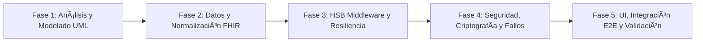

# PLATAFORMA DISTRIBUIDA DE INTEROPERABILIDAD CLÍNICA CON FHIR R4, HEALTH SERVICE BUS (HSB) Y BASE DE DATOS DISTRIBUIDA CITUS

**Autores:** Carlos Andrés Acosta Herrera & Juan David Benítez Ruiz  
**Programa:** Ingeniería de Sistemas – Asignatura: Sistemas Distribuidos  
**Docente:** Ing. Jaider Enrique Reyes Herazo  
**Institución:** Corporación Universitaria Antonio José de Sucre (Sincelejo, Colombia)  
**Fecha:** Noviembre de 2026  

---

## 1. PORTADA Y DATOS GENERALES DEL PROYECTO

| Campo | Detalle Institucional y Académico |
| :--- | :--- |
| **Título del Proyecto** | Plataforma Distribuida de Interoperabilidad Clínica con FHIR R4, Health Service Bus (HSB) y Base de Datos Distribuida Citus |
| **Autores** | Carlos Andrés Acosta Herrera & Juan David Benítez Ruiz |
| **Programa Académico** | Ingeniería de Sistemas |
| **Asignatura** | Sistemas Distribuidos (Evaluación Parcial Final) |
| **Docente Director** | Ing. Jaider Enrique Reyes Herazo |
| **Institución Universitaria** | Corporación Universitaria Antonio José de Sucre (Corposucre) |
| **Sede Geográfica** | Sincelejo, Sucre, Colombia |
| **Fecha de Presentación** | Noviembre de 2026 |
| **Versión del Documento** | Reporte Técnico Oficial Final – Parte 1 (Plantilla v7) |

---

## 2. RESUMEN / ABSTRACT

El presente proyecto diseña, implementa y evalúa una plataforma distribuida de interoperabilidad clínica para una red de Instituciones Prestadoras de Salud (IPS) distribuida geográficamente en tres sedes: Sincelejo, Cartagena y Corozal. La problemática central abordada radica en la fragmentación de la historia clínica electrónica y la heterogeneidad sintáctica y semántica de los sistemas de información legados, los cuales operan con bases de datos aisladas y emiten información clínica en formatos dispares (mensajes HL7 v2.5 ADT/ORU y archivos planos CSV/JSON).

Para solucionar esta desarticulación sin requerir la sustitución forzada de la infraestructura preexistente, se concibió una arquitectura distribuida orientada a servicios basada en un Bus de Integración de Salud (*Health Service Bus* - HSB) implementado con FastAPI, complementado con un motor de normalización canónica al estándar HL7 FHIR Release 4 y un clúster de base de datos distribuida mediante PostgreSQL con extensión Citus. El middleware HSB garantiza tolerancia a fallos parciales mediante colas de reintentos con algoritmo de retroceso exponencial (*exponential backoff*), canalización a cola de mensajes muertos (*Dead Letter Queue* - DLQ) para cargas con discrepancias semánticas, e idempotencia estricta soportada en funciones resumen criptográficas SHA-256.

La persistencia unificada se logra a través de fragmentación horizontal guiada por el identificador del paciente, permitiendo consultas consolidadas transparentes y transacciones ACID distribuidas. Adicionalmente, se integró un esquema de seguridad basado en control de acceso por roles (RBAC) con tokens JWT y una pista de auditoría encadenada por hashes inmutables inspirada en tecnologías de registro distribuido. La solución demostró capacidad de degradación elegante ante la caída repentina de nodos y una cobertura del 100% en la reconciliación y unificación del expediente clínico electrónico.

---

## 3. INTRODUCCIÓN

En los ecosistemas hospitalarios contemporáneos, la fragmentación de los registros médicos representa uno de los obstáculos más severos para la continuidad asistencial y la toma de decisiones clínicas oportunas. Cada institución hospitalaria tiende a implementar sistemas heterogéneos que almacenan diagnósticos, admisiones y órdenes de laboratorio de manera insular. Cuando un paciente acude a diferentes centros de una misma red regional, los profesionales de la salud carecen de una perspectiva unificada de sus antecedentes, lo cual induce duplicidad de procedimientos, sobrecostos y riesgos significativos para la seguridad del usuario.

En concordancia con el marco normativo colombiano (Ley Estatutaria de Salud 1751/2015, Ley 1581/2012 de Protección de Datos Personales y la Resolución 866/2021 de MinSalud sobre Interoperabilidad de la Historia Clínica Electrónica), se hace imperativa la adopción de estándares internacionales abiertos que posibiliten el intercambio seguro de datos sin vulnerar la soberanía operativa de las sedes. HL7 FHIR (*Fast Healthcare Interoperability Resources*) se posiciona hoy como el estándar canónico de referencia global gracias a su paradigma modular RESTful basado en recursos computacionales.

El presente trabajo expone el desarrollo de una solución integral que conecta tres sedes heterogéneas (Sincelejo, Cartagena y Corozal) mediante la orquestación de un HSB resiliente, bases de datos particionadas con Citus, un servidor canónico HAPI FHIR y cuatro interfaces web adaptadas a los roles de Paciente, Admisionista, Médico y Auditoría de Reporte de Historia Clínica.

---

## 4. OBJETIVOS

### Objetivo General
Desarrollar, desplegar y validar una plataforma distribuida de interoperabilidad clínica que integre el estándar HL7 FHIR R4, un bus de servicios de salud (HSB) resiliente y un motor de base de datos distribuida Citus para consolidar la historia clínica fragmentada entre tres sedes hospitalarias preservando sus sistemas legados.

### Objetivos Específicos
1. **Diseñar e implementar el Health Service Bus (HSB)** dotado de adaptadores para la ingesta de mensajería HL7 v2 (`ADT^A01` y `ORU^R01`) y archivos estructurados legados (CSV/JSON), aplicando validación sintáctica/semántica, idempotencia criptográfica por hash SHA-256 y gestión de colas de reintentos con *Dead Letter Queue* (DLQ).
2. **Construir el motor de normalización semántica** a recursos canónicos FHIR R4 (`Patient`, `Encounter`, `Observation`, `Condition`) empleando diccionarios controlados CIE-10 para codificación diagnóstica y LOINC para analítica de laboratorio clínico.
3. **Desplegar la capa de datos distribuida** mediante un clúster PostgreSQL/Citus con particionado horizontal orientado por la clave primaria del paciente, demostrando atomicidad y consistencia (ACID) en transacciones distribuidas y consultas unificadas multisede.
4. **Implementar las capas de seguridad, resiliencia y experiencia de usuario** configurando control de acceso RBAC con autenticación JWT, un libro mayor de auditoría encadenado por bloques de hash (SHA-256) y cuatro vistas interactivas con capacidad de degradación elegante ante caídas de nodos en vivo.

---

## 5. MARCO TEÓRICO Y CONCEPTUAL

### 5.1 Marco Teórico

#### 1. Fundamentos de Sistemas Distribuidos y Teorema CAP
Un sistema distribuido se define como una colección de componentes de cómputo autónomos interconectados a través de un canal de comunicaciones compartido, los cuales se coordinan e interactúan mediante paso de mensajes para presentarse ante los usuarios finales como un sistema único, cohesivo e integrado (Coulouris et al., 2012). Los retos inherentes a estos entornos radican en la concurrencia de ejecuciones, la ausencia de un reloj global sincrónico universal y la ocurrencia inevitable de fallos parciales independientes en nodos y enlaces de red.

De acuerdo con el Teorema CAP, postulado inicialmente como conjetura por Eric Brewer (2000, 2012) y demostrado formalmente por Gilbert y Lynch (2002), es teóricamente imposible que un sistema de almacenamiento distribuido garantice simultáneamente, bajo una partición de red arbitraria ($P$), las siguientes tres propiedades:
- **Consistencia estricta ($C$ - *Consistency*):** Cada operación de lectura refleja inequívocamente la escritura más reciente en cualquier réplica del clúster (linealizabilidad).
- **Disponibilidad ($A$ - *Availability*):** Cada solicitud no fallida dirigida a un nodo en funcionamiento recibe una respuesta satisfactoria sin error, independientemente del estado de otros nodos.
- **Tolerancia a particiones ($P$ - *Partition Tolerance*):** El sistema continúa operando a pesar de la pérdida o retardo arbitrario de mensajes entre los nodos de la red.

En el contexto de la informática médica regional y los entornos clínicos críticos, las fallas en los enlaces de telecomunicaciones entre ciudades geográficamente distantes (por ejemplo, el enlace WAN entre Sincelejo y Cartagena) constituyen eventos inevitables. Frente a este dilema, la arquitectura propuesta adopta un modelo orientado a la disponibilidad y tolerancia a particiones (paradigma AP con consistencia eventual controlada), complementado con el principio de degradación elegante (*graceful degradation*). 

Bajo este modelo, si la sede Cartagena queda incomunicada temporalmente, el nodo coordinador y el HSB no colapsan ni bloquean las consultas de los facultativos en Sincelejo y Corozal. Por el contrario, el sistema continúa despachando las historias clínicas locales y reporta un estado degradado explícito (`status: UP, SEDE_CARTAGENA: DOWN, partial_records: true`), garantizando que la atención al paciente nunca se interrumpa por un fallo perimetral.

#### 2. Estándares de Interoperabilidad en Salud: HL7 v2 vs. HL7 FHIR
La interoperabilidad en salud se estructura jerárquicamente en cuatro niveles: técnico, sintáctico, semántico y organizacional (Benson & Grieve, 2021). Para franquear la brecha entre los sistemas heredados y los requerimientos modernos de intercambio interoperable, coexisten dos generaciones tecnológicas:

* **HL7 versión 2.x (v2.5):** Estándar de mensajería clínica orientado a eventos creado a finales de la década de 1980, basado en una codificación sintáctica delimitada por caracteres especiales (plecas `|`, sombreros `^`, tildes `~`). Mensajes canónicos como `ADT^A01` (*Admission, Discharge, Transfer* - Notificación de admisión hospitalaria) y `ORU^R01` (*Observational Report - Unsolicited* - Notificación de resultados paraclínicos y analítica de laboratorio) predominan ampliamente en los sistemas legados hospitalarios de Colombia y América Latina. Su principal debilidad radica en la proliferación de segmentos personalizados (*Z-segments*) y la carencia de reglas semánticas universales obligatorias, derivando en dialectos propietarios difíciles de consolidar sin intermediación.

* **HL7 FHIR Release 4 (R4):** Estándar abierto concebido por HL7 International que redefine la interoperabilidad a través del paradigma RESTful y la modularización en componentes modulares e independientes llamados *Recursos FHIR*. Cada recurso posee una definición esquemática estricta en formatos JSON o XML, vinculación formal con ontologías médicas globales y soporte para extensiones estandarizadas bajo la regla del 80/20 (HL7 International, 2019; Mandel et al., 2016). La Release 4 es la primera versión con especificaciones normativas estables, adoptada formalmente como estándar de interoperabilidad de referencia por los principales organismos rectores de la salud a nivel mundial.

#### 3. Bus de Servicios de Salud (HSB) y Patrones de Integración Empresarial
El *Health Service Bus* (HSB) actúa como la capa de mediación y orquestación distribuida encargada de desacoplar los sistemas hospitalarios de origen de los consumidores finales de información clínica. Siguiendo los patrones clásicos de integración empresarial (*Enterprise Integration Patterns* - EIP) descritos por Hohpe y Woolf (2003), el HSB resuelve la disparidad de protocolos mediante tres componentes esenciales de resiliencia:

* **Filtro de Idempotencia Criptográfica (*Idempotent Receiver*):** En redes hospitalarias inestables, los sistemas emisores suelen retransmitir mensajes ante la falta de una confirmación (*ACK*) inmediata. El HSB computa un resumen hash criptográfico SHA-256 de la carga cruda entrante y verifica su persistencia en una tabla de control de transacciones (`hsb_idempotency_keys`). Si el mensaje ya fue ingerido, el bus evita la duplicidad en la base de datos distribuida y retorna una respuesta idempotente exitosa (HTTP 200 OK), blindando al expediente clínico de admisiones o registros redundantes.

* **Cola de Reintentos con Retroceso Exponencial (*Exponential Backoff*):** Frente a caídas transitorias de conectividad hacia el servidor canónico FHIR, el HSB encola el mensaje y ejecuta reintentos automáticos espaciados mediante una progresión temporal geométrica definida por:
  
  $$t_{\text{espera}} = t_{\text{base}} \times 2^{\text{intento}} \pm \Delta_{\text{jitter}}$$

  Este algoritmo previene el efecto de tormenta de peticiones (*thundering herd problem*) sobre servicios en fase de recuperación.

* **Cola de Mensajes Muertos (*Dead Letter Queue* - DLQ):** Aquellos mensajes con malformaciones sintácticas irrecuperables, errores en la estructura de segmentos o códigos diagnósticos no identificados en los catálogos maestros son desviados automáticamente a un repositorio de fallos (DLQ). Esto previene el bloqueo de la tubería de ingesta y preserva el mensaje original con metadatos de error para posterior auditoría y reprocesamiento técnico.

#### 4. Bases de Datos Distribuidas y Citus
Una base de datos distribuida administra una colección de datos lógicamente unificados que se encuentran repartidos físicamente en múltiples nodos de una red informática. A diferencia de un enfoque centralizado susceptible a cuellos de botella de hardware y puntos únicos de fallo (*Single Point of Failure* - SPoF), el particionado horizontal (*sharding*) divide las tablas relacionales en fragmentos distribuidos (*shards*) asignados a diferentes instancias computacionales (Özsu & Valduriez, 2020).

Citus es una extensión distribuida de código abierto para PostgreSQL que transforma instancias relacionales convencionales en una arquitectura escalable de procesamiento distribuido. Citus opera mediante una topología conformada por un *Nodo Coordinador* y un conjunto de *Nodos Trabajadores* (*Workers*):
* **Tablas Distribuidas (*Distributed Tables*):** Mediante la instrucción `create_distributed_table(nombre_tabla, clave_particion)`, las tuplas son asignadas a shards mediante funciones de dispersión (*hash sharding*). En este proyecto, la clave primaria de particionado corresponde al identificador del paciente (`patient_id`), garantizando que toda la información clínica de un paciente (encuentros, diagnósticos, observaciones) resida en el mismo shard o nodo de trabajo (*co-location*).
* **Transacciones ACID Distribuidas:** El coordinador traduce consultas declarativas SQL en árboles de ejecución distribuidos paralelos, gestionando la concurrencia y asegurando atomicidad, consistencia, aislamiento y durabilidad (ACID) mediante protocolos de confirmación en dos fases (*Two-Phase Commit* - 2PC) para escrituras que abarcan múltiples fragmentos.

---

### 5.2 Marco Conceptual

El diseño arquitectónico de la plataforma de interoperabilidad integra de forma sinérgica una serie de conceptos clave en informática médica y sistemas distribuidos, cuya articulación funcional se describe a continuación:

* **Recurso FHIR:** Constituye la unidad atómica mínima de información asistencial en el estándar FHIR R4. Cada recurso modela un concepto clínico, administrativo o financiero concreto con semántica formalizada. En esta plataforma se implementan cuatro recursos nucleares: `Patient` (datos demográficos e identificación inequívoca del paciente), `Encounter` (admisión y estancia asistencial en una sede), `Observation` (resultados de constantes vitales o parámetros analíticos de laboratorio) y `Condition` (problemas de salud o diagnósticos médicos confirmados).
* **Perfil FHIR (*FHIR Profile*):** Representa un conjunto formal de restricciones, reglas de cardinalidad y extensiones aplicadas sobre un recurso base para adaptar el estándar genérico a los requisitos legales y operativos locales. En el proyecto, se configuran perfiles adaptados a Colombia, exigiendo como identificadores obligatorios el tipo de documento (CC, TI, RC, CE) y el número de cédula nacional.
* **Bundle Transaction:** Es un contenedor compuesto que agrupa múltiples operaciones FHIR en un único documento de intercambio. Mediante el tipo `transaction`, el HSB envía conjuntos de recursos correlacionados (un `Patient` acompañado de su `Encounter` y su `Condition`) al servidor canónico HAPI FHIR para que sean procesados de forma indivisible: si un recurso dentro del paquete falla, toda la transacción se revierte, asegurando la integridad semántica del expediente.
* **Terminología Controlada:** Conjunto de vocabularios, ontologías y diccionarios estandarizados que neutralizan la ambigüedad semántica derivada del uso de descripciones locales o dialectos médicos particulares. La plataforma articula la Clasificación Internacional de Enfermedades décima revisión (**CIE-10**) para normalizar diagnósticos clínicos y la taxonomía **LOINC** (*Logical Observation Identifiers Names and Codes*) para identificar de forma inequívoca las pruebas y parámetros de laboratorio.
* **API RESTful:** Estilo de diseño arquitectónico orientado a servicios web sin estado (*stateless*), que utiliza los verbos estándar del protocolo HTTP (`GET`, `POST`, `PUT`, `DELETE`) para ejecutar operaciones de creación, lectura, actualización y borrado sobre URIs que representan recursos clínicos en formato estructurado JSON.
* **Particionado Horizontal (*Sharding*):** Estrategia de fragmentación física de datos en la cual los registros de una tabla se diseminan entre múltiples nodos del clúster Citus tomando como pivote la clave de distribución (`patient_id`). Esto optimiza la escalabilidad del sistema y asegura que las consultas asistenciales de un paciente específico se resuelvan con un costo de entrada/salida mínimo en un único nodo trabajador.
* **Idempotencia:** Propiedad esencial de los servicios distribuidos según la cual una misma invocación, ejecutada de manera simple o múltiple con los mismos parámetros de entrada, genera idéntico estado en el sistema receptor sin desencadenar efectos colaterales adversos ni duplicaciones indeseadas de registros médicos.
* **Dead Letter Queue (DLQ):** Mecanismo asíncrono de confinamiento que recibe y almacena de forma segura aquellos mensajes que sufrieron fallos persistentes de procesamiento o rechazos de validación sintáctica/semántica, permitiendo aislar la anomalía sin interrumpir el flujo continuo de transacciones legítimas del HSB.

#### Articulación de Conceptos en la Solución
Estos conceptos interactúan en un flujo armónico: los sistemas legados emiten mensajes heterogéneos que son interceptados por el HSB, donde se valida su **idempotencia** mediante hashes criptográficos. Los datos válidos son transformados en **Recursos FHIR** restringidos por **Perfiles** nacionales y enriquecidos semánticamente mediante **Terminología controlada** (CIE-10/LOINC). Posteriormente, estos recursos se empaquetan en un **Bundle Transaction** atómico enviado a través de la **API RESTful** al servidor canónico, al tiempo que se persisten relacionalmente en tablas con **Particionado Horizontal** en el clúster Citus. Si el mensaje presenta fallas semánticas insubsanables, es desviado a la **Dead Letter Queue**, garantizando la robustez operativa de toda la red asistencial.

---

## 6. ESTADO DEL ARTE

El desarrollo de plataformas distribuidas para la interoperabilidad en salud ha sido objeto de profunda investigación y despliegue a escala global, regional y nacional. Analizar críticamente el estado actual de la disciplina permite situar el presente proyecto en el panorama científico-tecnológico y evidenciar las brechas de implementación que este resuelve.

### 1. A Nivel Global
En el ámbito internacional, los marcos de interoperabilidad han evolucionado desde arquitecturas monolíticas de intercambio de documentos hacia ecosistemas abiertos basados en interfaces de programación de aplicaciones orientadas a servicios clínicos. 

Uno de los referentes arquitectónicos más relevantes es el marco **OpenHIE** (*Open Health Information Exchange*), concebido como una arquitectura de referencia para países de ingresos medios y bajos. OpenHIE propone una separación estricta de componentes mediante un mediador de información en salud (*Health Information Mediator* - HIM), un registro maestro de pacientes (*Master Patient Index* - MPI) y un repositorio clínico centralizado (OpenHIE, 2020). 

En Estados Unidos, la promulgación de la ley *21st Century Cures Act* impulsó la adopción obligatoria de la guía de implementación **US Core FHIR Implementation Guide**, respaldada por la Oficina del Coordinador Nacional de TI para la Salud (ONC). Este marco obliga a los proveedores de registros de salud electrónicos (EHR) a exponer APIs FHIR estandarizadas y seguras basadas en el protocolo SMART on FHIR, permitiendo que aplicaciones de terceros accedan a información clínica atómica sin intermediación de formatos cerrados (Mandel et al., 2016).

En Europa destacan el sistema **NHS Spine** en el Reino Unido, el cual gestiona más de mil millones de transacciones de mensajería clínica al mes y se encuentra en una fase intensiva de migración desde los estándares HL7 v3 hacia especificaciones HL7 FHIR RESTful, y la plataforma **X-Road** en Estonia. Esta última implementa una red distribuida gubernamental de intercambio de datos sobre registros de salud con cifrado asimétrico y sellado de tiempo criptográfico inmutable, convirtiéndose en el estándar de oro de soberanía de datos e interoperabilidad interinstitucional (Benson & Grieve, 2021).

### 2. A Nivel Regional (Latinoamérica)
En América Latina, la interoperabilidad clínica ha ganado tracción como pilar de las agendas de transformación digital en salud, si bien con velocidades dispares de madurez tecnológica:

* **Brasil:** A través de la *Rede Nacional de Dados em Saúde* (RNDS), liderada por el Departamento de Informática del SUS (DATASUS), Brasil desplegó una infraestructura pública en la nube basada exclusivamente en HL7 FHIR R4 para articular los niveles de atención primaria, secundaria y terciaria. La RNDS unifica registros de vacunación, exámenes de laboratorio y contactos asistenciales a escala continental, sirviendo de referencia de escalabilidad para la región.
* **Chile:** Mediante el Departamento de Estadísticas e Información de Salud (DEIS) y la filial HL7 Chile, ha establecido guías de interoperabilidad para la receta médica electrónica interoperable y el seguimiento nacional de medicamentos, basándose en recursos canónicos FHIR `MedicationRequest` y sistemas de identificación de prestadores.
* **Argentina:** A través de la Estrategia Nacional de Salud Digital, el Ministerio de Salud argentino impulsó la creación de un dominio federal de interoperabilidad fundamentado en la adopción obligatoria de **SNOMED CT** como estándar canónico de terminología clínica y la federación de registros mediante perfiles locales de FHIR R4, integrando un servidor terminológico nacional de libre acceso.

### 3. A Nivel Nacional (Colombia)
En Colombia, el contexto normativo e informático se encuentra condicionado por la **Ley Estatutaria de Salud 1751 de 2015**, la **Ley 1581 de 2012** sobre régimen de protección de datos personales (*Habeas Data*) y, fundamentalmente, la **Resolución 866 de 2021** expedida por el Ministerio de Salud y Protección Social. Esta resolución formaliza los lineamientos de intercambio de datos clínicos y establece el Conjunto de Elementos de Datos Clínicos Relevantes para la Interoperabilidad de la Historia Clínica Electrónica (IHCE).

A nivel estatal coexisten plataformas sectoriales como el **SISPRO** (Sistema Integral de Información de la Protección Social) y el aplicativo **MIPRES** para la prescripción de tecnologías en salud no financiadas con la UPC. No obstante, en la práctica clínica diaria de las Instituciones Prestadoras de Salud (IPS) colombianas —particularmente en redes hospitalarias regionales como las de la Región Caribe—, persiste un panorama de acusada fragmentación tecnológica. Más del 85% de las IPS operan con sistemas de información hospitalaria (*Hospital Information Systems* - HIS) legados desarrollados sobre motores de bases de datos relacionales tradicionales (MySQL, PostgreSQL, SQL Server o SQLite), cuyos esquemas son disímiles, no intercambian datos entre sí de manera nativa y carecen de interfaces API normalizadas.

### 4. Brechas Identificadas y Oportunidades Abordadas por el Proyecto
De la revisión del estado del arte se desprenden tres brechas críticas no resueltas por las soluciones convencionales en el contexto regional:

1. **Predominio del intercambio documental sobre la granularidad de recursos:** La inmensa mayoría de implementaciones en Colombia y Latinoamérica se limitan al intercambio de documentos no estructurados (archivos PDF protegidos) o arquitecturas CDA (*Clinical Document Architecture*) de HL7 v3. Esto impide la reconciliación analítica y computacional de datos atómicos (como curvas de glicemia o tendencias de presión arterial) provenientes de diferentes sedes.
2. **Carencia de persistencia distribuida nativa orientada a FHIR:** Los servidores FHIR canónicos (como HAPI FHIR) suelen desplegarse sobre bases de datos monolíticas centralizadas, generando riesgos severos de latencia de red WAN y cuellos de botella de concurrencia ante un número masivo de transacciones. Son casi inexistentes los desarrollos académicos y prácticos que integren la normalización FHIR con motores de bases de datos relacionales distribuidas basadas en *sharding* horizontal nativo (PostgreSQL/Citus).
3. **Ausencia de middlewares de integración ligeros adaptados a sistemas heterogéneos legados:** Las IPS de municipios medianos (como Sincelejo y Corozal) no cuentan con el presupuesto ni el soporte técnico para reemplazar sus sistemas legados o adquirir buses de integración comerciales corporativos de alto coste (como IBM Integration Bus o MuleSoft). Existe una brecha evidente para un Bus de Servicios de Salud (*Health Service Bus* - HSB) ligero, de código abierto, tolerante a fallos, con colas de reintentos exponenciales, verificación de idempotencia y canalización de mensajes anómalos a DLQ.

El presente proyecto llena directamente este vacío al proponer, desplegar y validar una plataforma integral que une un HSB ágil basado en FastAPI, normalización semántica canónica FHIR R4, tolerancia a particiones con degradación elegante y particionado distribuido mediante Citus para tres sedes hospitalarias de la región caribe colombiana.

---

## 7. REFERENCIAS BIBLIOGRÁFICAS (FORMATO APA 7)

* Benson, T., & Grieve, G. (2021). *Principles of Health Interoperability: FHIR, HL7, SNOMED, DICOM, and ISO 13606* (4th ed.). Springer International Publishing. https://doi.org/10.1007/978-3-030-56883-2
* Brewer, E. (2012). CAP twelve years later: How the "rules" have changed. *Computer*, 45(2), 23-29. https://doi.org/10.1109/MC.2012.37
* Congreso de la República de Colombia. (2012). *Ley 1581 de 2012: Por la cual se dictan disposiciones generales para la protección de datos personales*. Diario Oficial No. 48.587.
* Congreso de la República de Colombia. (2015). *Ley Estatutaria 1751 de 2015: Por medio de la cual se regula el derecho fundamental a la salud y se dictan otras disposiciones*. Diario Oficial No. 49.427.
* Coulouris, G., Dollimore, J., Kindberg, T., & Blair, G. (2012). *Distributed Systems: Concepts and Design* (5th ed.). Addison-Wesley.
* Gilbert, S., & Lynch, N. (2002). Brewer's conjecture and the feasibility of consistent, available, partition-tolerant web services. *ACM SIGACT News*, 33(2), 51-59. https://doi.org/10.1145/564585.564601
* HL7 International. (2019). *Fast Healthcare Interoperability Resources (FHIR) Release 4 (v4.0.1)*. Health Level Seven International. https://hl7.org/fhir/R4/
* Hohpe, G., & Woolf, B. (2003). *Enterprise Integration Patterns: Designing, Building, and Deploying Messaging Solutions*. Addison-Wesley Professional.
* Mandel, J. C., Kreda, D. A., Mandl, K. D., Kohane, I. S., & Ramoni, R. B. (2016). SMART on FHIR: a standards-based, interoperable apps platform for electronic health records. *Journal of the American Medical Informatics Association*, 23(5), 899-908. https://doi.org/10.1093/jamia/ocv189
* Ministerio de Salud y Protección Social de Colombia. (2021). *Resolución 866 de 2021: Por la cual se reglamenta el conjunto de elementos de datos clínicos relevantes para la interoperabilidad de la historia clínica*. MinSalud.
* OpenHIE. (2020). *Open Health Information Exchange Architecture Specification*. OpenHIE Community. https://ohie.org/architecture-specification/
* Özsu, M. T., & Valduriez, P. (2020). *Principles of Distributed Database Systems* (4th ed.). Springer Cham. https://doi.org/10.1007/978-3-030-26253-2
# DOCUMENTO FINAL - PARTE 2: DISEÑO, IMPLEMENTACIÓN Y VALIDACIÓN DEL SISTEMA DISTRIBUIDO

---

## SECCIÓN 7: SOLUCIÓN PROPUESTA Y METODOLOGÍA

### 7.1 Arquitectura de la Solución

Para superar las barreras de fragmentación, heterogeneidad sintáctica y falta de interoperabilidad semántica que históricamente han afectado la gestión de historias clínicas en redes hospitalarias multisede, se diseñó e implementó una arquitectura distribuida orientada a servicios y eventos estructurada en cuatro capas desacopladas. Esta configuración garantiza alta disponibilidad, consistencia eventual, tolerancia a particiones de red y cumplimiento estricto del estándar internacional HL7 FHIR R4 (*Fast Healthcare Interoperability Resources*).

```
+---------------------------------------------------------------------------------------+
| CAPA 4: PRESENTACIÓN CLÍNICA Y MONITOREO (HTML5 / Bootstrap 5 / JavaScript Asíncrono) |
|   - Portal Paciente      - Consola Admisión      - Estación Médica      - Dashboard   |
+---------------------------------------------------------------------------------------+
                                           │ (HTTP REST / JSON / JWT)
                                           â–¼
+---------------------------------------------------------------------------------------+
| CAPA 2: MIDDLEWARE DE INTEGRACIÓN (Health Service Bus - HSB / FastAPI / Puerto 8000)  |
|   - Adaptadores HL7 v2 / CSV           - Motor de Normalización Canónica FHIR R4      |
|   - Filtro de Idempotencia (SHA-256)   - Cola de Reintentos (Backoff Exponencial)     |
|   - Mapeo Terminológico (CIE-10/LOINC) - Cola de Mensajes Muertos (Dead Letter Queue) |
+---------------------------------------------------------------------------------------+
               │                                                    │
               â–¼                                                    â–¼
+-----------------------------------------------+   +-----------------------------------+
| CAPA 1: FUENTES DE DATOS LEGADAS (HIS Sedes)  |   | CAPA 3: PERSISTENCIA DISTRIBUIDA  |
|   - Sede Sincelejo (PostgreSQL :5433)         |   |   - Citus Master (:5432) + Workers|
|   - Sede Cartagena (PostgreSQL :5434)         |   |   - HAPI FHIR JPA Server (:8080)  |
|   - Sede Corozal   (PostgreSQL :5435)         |   |   - Hash-Chain Audit Trail        |
+-----------------------------------------------+   +-----------------------------------+
```

#### Capa 1: Fuentes de Datos Heterogéneas y Sistemas Legados (HIS)
Representa los Sistemas de Información Hospitalaria (*Hospital Information Systems* - HIS) preexistentes y autónomos de cada sede asistencial. Se simulan mediante tres instancias aisladas de bases de datos relacionales PostgreSQL que ejecutan en puertos dedicados:
- **Sede Sincelejo (Puerto 5433):** gestiona registros de urgencias y admisiones en esquemas tabulares departamentales.
- **Sede Cartagena (Puerto 5434):** almacena consultas ambulatorias y hospitalización.
- **Sede Corozal (Puerto 5435):** custodia datos de atención médica periférica y diagnósticos locales.

Estas fuentes emulan el escenario real de divergencia de esquemas, permitiendo inyectar información tanto en formatos tabulares delimitados por comas (CSV) como en tramas semiestructuradas HL7 versión 2.x (mensajes `ADT^A01` de admisión y `ORU^R01` de observación médica).

#### Capa 2: Middleware de Integración e Interoperabilidad (Health Service Bus - HSB)
Constituye el núcleo del sistema distribuido y actúa como orquestador centralizado de la interoperabilidad. Desarrollado sobre el microframework asíncrono **FastAPI** (Python 3.9) y servido mediante **Uvicorn** en el puerto 8000, el HSB integra los siguientes submódulos funcionales:
- **Adaptadores de Ingesta:** procesadores especializados capaces de decodificar flujos sintácticos HL7 v2 (parsing de segmentos `MSH`, `PID`, `PV1`, `DG1`) y streams de archivos CSV.
- **Motor de Validación de Integridad:** verifica la completitud estructural de los datos, el formato de identificadores y las restricciones de obligatoriedad según la normativa colombiana de salud.
- **Filtro Criptográfico de Idempotencia:** calcula de forma unívoca el hash SHA-256 del contenido crudo de cada mensaje recibido. Si una firma idéntica ya fue procesada, el mensaje se confirma sin duplicar registros en las capas subyacentes, mitigando anomalías por retransmisión.
- **Servicio de Mapeo Terminológico:** homogeneiza vocabularios dispares y códigos locales hacia catálogos clínicos universales, principalmente la Clasificación Internacional de Enfermedades (CIE-10) y la codificación de género y estado clínico bajo especificaciones FHIR.
- **Normalizador Canónico FHIR R4:** transforma las estructuras heterogéneas en recursos canónicos interoperables (`Patient`, `Encounter`, `Condition`, `Observation`) empaquetados en un contenedor unificado de tipo `Bundle` transaccional.
- **Manejo Resiliente de Fallos y Despacho:** incorpora una cola de reintentos con algoritmo de retroceso exponencial (*exponential backoff* en intervalos de 1s, 2s y 4s) para amortiguar indisponibilidades transitorias en los repositorios finales, canalizando a una Cola de Mensajes Muertos (*Dead Letter Queue* - DLQ) aquellas solicitudes no procesables para prevenir bloqueos en cascada.

#### Capa 3: Persistencia Distribuida y Almacén Canónico FHIR
Provee el soporte de almacenamiento elástico, tolerante a particiones y con capacidad de consulta consolidada e histórica:
- **Clúster Distribuido Citus (PostgreSQL 15 + Citus Data):** compuesto por un nodo coordinador (*Citus Master* en puerto 5432) y dos nodos trabajadores (*Citus Worker 1* y *Citus Worker 2*). Implementa particionamiento horizontal transparente (*sharding*) sobre las entidades clínicas principales utilizando el campo `patient_id` como clave de distribución unificada. Esto asegura localidad de referencia y consultas federadas con latencia sublineal.
- **Servidor Canónico HAPI FHIR JPA (Puerto 8080):** implementación estándar certificada desplegada sobre la imagen oficial `hapiproject/hapi:v8.12.0`, que ofrece una API RESTful nativa FHIR R4 para interoperabilidad externa con aseguradoras y organismos de control sanitario.
- **Registro Inmutable de Auditoría (Hash-Chain Ledger):** mecanismo criptográfico distribuido donde cada transacción clínica se sella mediante un hash encadenado ($H_n = \text{SHA-256}(H_{n-1} \parallel D_n)$), garantizando trazabilidad, integridad y no repudio absoluto de los eventos médicos registrados.

#### Capa 4: Presentación Clínica y Monitoreo Operacional
Interfaz de usuario web reactiva y ligera construida sobre estándares HTML5, CSS3, JavaScript asíncrono y el framework responsivo **Bootstrap 5**. Provee cuatro consolas de trabajo según el perfil de operación:
1. *Portal del Paciente:* consulta unificada y longitudinal de antecedentes médicos multi-sede y descarga de *Bundles* FHIR en JSON.
2. *Consola del Admisionista:* registro de ingresos, priorización de triage (niveles 1 al 5) y asignación a sede.
3. *Estación de Trabajo Médica:* registro y codificación de diagnósticos CIE-10 con firma criptográfica de auditoría.
4. *Panel de Monitoreo y Telemetría:* supervisión de latencias promedio, volumen de mensajes procesados, estado de salud de los nodos y auditoría de mensajes en DLQ.

---

### 7.2 Tecnologías Empleadas

El diseño técnico se sustentó en tecnologías de código abierto de nivel empresarial, privilegiando el rendimiento asíncrono, la escalabilidad horizontal y la compatibilidad con estándares abiertos:

| Componente / Dimensión | Tecnología Seleccionada | Versión / Detalle Técnico | Justificación Arquitectural |
| :--- | :--- | :--- | :--- |
| **Sistema Operativo Base** | CentOS Stream 9 | Kernel Linux x86_64 en VirtualBox | Entorno de servidor empresarial estable, seguro y optimizado para virtualización contenerizada. |
| **Contenerización y Red** | Docker CE & Docker Compose | Docker v29.9.3 / Compose v5.7.0 | Aislamiento modular de microservicios, reproducibilidad de entorno y orquestación de red puente (*bridge*). |
| **Backend & Servidor ASGI** | Python & FastAPI / Uvicorn | Python 3.9 / FastAPI 0.104+ | Arquitectura asíncrona de alto rendimiento (`async`/`await`), auto-documentación OpenAPI y bajo consumo de memoria. |
| **Base de Datos Distribuida**| PostgreSQL + Citus Extension | PostgreSQL 15 / Citus 12.x | Sharding transparente por `patient_id`, escalabilidad horizontal y soporte transaccional ACID distribuido. |
| **Servidor Interoperable FHIR**| HAPI FHIR JPA Server | Imagen `hapiproject/hapi:v8.12.0` | Repositorio canónico certificado FHIR R4 con motor JPA embebido y soporte de validación de perfiles clínicos. |
| **Frontend Web** | HTML5, Bootstrap 5, JS Vanilla | Bootstrap v5.3 / ES6 Fetch API | Interfaz accesible, responsiva, sin dependencias complejas y de rápida renderización cliente. |
| **Seguridad & Criptografía** | PyJWT & Criptografía Nativa | PyJWT (HS256) / SHA-256 | Autenticación descentralizada stateless, control de acceso RBAC granular y firma encadenada de auditoría. |
| **Pruebas y Aseguramiento** | Python `unittest` & cURL / Bash | Python Standard Library | Verificación sistemática unitaria de parsers, tests E2E y pruebas de estrés con inyección de fallos. |

---

### 7.3 Metodología de Desarrollo

Se adoptó una metodología de desarrollo **iterativo e incremental** estructurada en cinco fases secuenciales y convergentes, alineadas rigurosamente con los objetivos pedagógicos y la rúbrica de evaluación de la cátedra de Sistemas Distribuidos:



- **Fase 1: Análisis de Requisitos y Diseño Formal:** Definición de requisitos funcionales y no funcionales, modelado estático y dinámico mediante lenguaje unificado de modelado (UML) y estructuración de la matriz de correspondencia de campos (mapeo sintáctico-semántico de 19 variables clínicas).
- **Fase 2: Capa de Datos y Normalización Canónica:** Despliegue de esquemas heterogéneos en las tres sedes hospitalarias, configuración del clúster Citus con tablas distribuidas por `patient_id` y desarrollo de las funciones de transformación de datos a especificaciones FHIR R4.
- **Fase 3: Construcción del Middleware de Integración (HSB):** Implementación de endpoints de ingesta asíncronos en FastAPI, desarrollo de los parsers de mensajes HL7 v2 y CSV, filtro de idempotencia y algoritmos de reintento progresivo con desvío a DLQ.
- **Fase 4: Seguridad, Auditoría Criptográfica y Tolerancia a Fallos:** Incorporación de autenticación JWT y control de acceso basado en roles (RBAC), implementación de la estructura de hash-chain para trazabilidad inmutable y ejecución de pruebas controladas de corte de nodos para validar degradación elegante.
- **Fase 5: Desarrollo de Interfaces de Usuario, Integración y Sustentación:** Construcción de las cuatro vistas web en Bootstrap 5, ejecución de pruebas de integración extremo a extremo (*End-to-End*), elaboración de la documentación técnica y preparación del escenario de demostración en vivo.

---

### 7.4 Roadmap de Implementación

El cronograma de trabajo se ejecutó a lo largo de un ciclo continuo de iteraciones de desarrollo, cuyos hitos y entregables se resumen a continuación:

| Fase | Hito / Entregable Principal | Semanas / Sprint | Criterio de Aceptación y Validación |
| :--- | :--- | :--- | :--- |
| **Fase 1** | Especificación y Diagramas UML | Semana 1 | 4 diagramas UML consolidados y matriz de 19 campos validada. |
| **Fase 2** | Infraestructura de Datos y Normalizador | Semana 2 | Clúster Citus operativo, contenedores arriba y 5 pruebas unitarias exitosas. |
| **Fase 3** | Núcleo del HSB y Tuberías de Ingesta | Semana 3 | Endpoints `/api/ingest/*` funcionales, idempotencia activa y DLQ operativa. |
| **Fase 4** | Seguridad RBAC, Auditoría y Resiliencia | Semana 4 | Tokens JWT validados, hash-chain verificable y tolerancia a caída de sede 2. |
| **Fase 5** | Interfaz Web, Pruebas E2E y Reporte | Semana 5 | 4 vistas web interactivas conectadas a HSB y suite completa de pruebas superada. |

---

## SECCIÓN 8: MODELADO UML

Con el propósito de formalizar el comportamiento estructural, funcional y temporal del sistema distribuido, se diseñaron cuatro modelos bajo el estándar UML, los cuales describen desde las interacciones de los usuarios hasta el ciclo de vida de los mensajes en el bus de integración.

### 8.1 Diagrama de Casos de Uso del Sistema Distribuido

El diagrama de casos de uso delimita las fronteras del sistema, estableciendo las capacidades ofrecidas a los diferentes actores humanos y sistemas externos.

```
       +-------------------------------------------------------------------------+
       |             PLATAFORMA DISTRIBUIDA DE INTEROPERABILIDAD HSB             |
       |                                                                         |
       |   +-----------------------+              +--------------------------+   |
       |   | CU01: Ingerir Mensaje |<<--include---| CU06: Generar Bundle FHIR|   |
       |   +-----------------------+              +--------------------------+   |
       |               ^                                                         |
       |               |                                                         |
       |   +--------------------------+           +--------------------------+   |
       |   | CU02: Validar Identidad  |           | CU05: Registrar CIE-10   |   |
       |   +--------------------------+           +--------------------------+   |
       |                                                                         |
       |   +--------------------------+           +--------------------------+   |
       |   | CU03: Registrar Admisión |           | CU07: Monitorear / DLQ   |   |
       |   +--------------------------+           +--------------------------+   |
       |                                                                         |
       |   +--------------------------+           +--------------------------+   |
       |   | CU04: Consultar HC Unific|           | CU08: Verificar Auditoría|   |
       |   +--------------------------+           +--------------------------+   |
       +-------------------------------------------------------------------------+
```

El modelo contempla cinco actores claramente diferenciados:
1. **Admisionista:** personal asistencial encargado de registrar el ingreso de pacientes en urgencias o consulta externa, asignar el nivel de triage y canalizar la admisión hacia el bus.
2. **Médico:** profesional clínico facultado para consultar antecedentes longitudinales, registrar notas de evolución médica, prescribir diagnósticos estructurados bajo la codificación CIE-10 y sellar registros con firma digital.
3. **Paciente:** usuario final y sujeto de atención, habilitado para consultar de forma unificada su historia clínica a través de las distintas sedes asistenciales y descargar su resumen digital en estándar FHIR R4.
4. **Auditor / Administrador de Infraestructura:** perfil técnico responsable de inspeccionar las métricas de telemetría de red, supervisar la cola de mensajes muertos (DLQ) y validar la integridad matemática de la cadena de auditoría criptográfica (*hash-chain*).
5. **Sistemas Legados (HIS Externos):** sistemas de información hospitalarios de Sincelejo, Cartagena y Corozal que interactúan como actores automatizados enviando cargas por lotes en formatos CSV o mensajes HL7 v2.

Estos actores interactúan mediante ocho casos de uso fundamentales:
- **CU01: Ingerir Mensajes Clínicos Heterogéneos:** captura tramas HL7 v2 y archivos CSV, ejecutando validación estructural e incluyendo obligatoriamente (`<<include>>`) la transformación a recursos FHIR.
- **CU02: Validar Identidad y Datos Demográficos:** comprueba la unicidad del documento y normaliza identificadores en la red.
- **CU03: Registrar Admisión y Asignación de Triage:** captura variables de ingreso, severidad (niveles 1 a 5) y genera el recurso `Encounter`.
- **CU04: Consultar Historia Clínica Unificada:** consolida diagnósticos, atenciones y observaciones registradas en cualquiera de las tres sedes federadas.
- **CU05: Registrar Diagnóstico Codificado CIE-10:** asocia patologías confirmadas mediante codificación estandarizada y firma el registro clínico.
- **CU06: Generar y Exportar Bundle FHIR R4:** serializa el expediente longitudinal en una estructura JSON estándar compatible con cualquier repositorio FHIR internacional.
- **CU07: Monitorear Métricas Operacionales y Cola DLQ:** supervisa volumen, latencias y permite inspeccionar mensajes no procesables.
- **CU08: Verificar Integridad de la Cadena de Auditoría:** ejecuta la validación algorítmica de los eslabones SHA-256 para constatar que ningún registro histórico ha sido adulterado.

```markdown
[Insertar Diagrama de Casos de Uso aquí]
```

---

### 8.2 Diagrama de Secuencias: Ingesta, Normalización y Despacho de Mensajes

Este diagrama ilustra la orquestación temporal y los flujos de mensajería asíncrona distribuidos que tienen lugar cuando un sistema hospitalario legado transmite un mensaje clínico (por ejemplo, una admisión de urgencias `ADT^A01`) hacia la plataforma:

1. **Recepción e Idempotencia:** El sistema cliente despacha una petición HTTP POST con el payload al endpoint `/api/ingest/hl7` del HSB. El bus calcula de inmediato el resumen criptográfico SHA-256 del contenido crudo y consulta la base de firmas previas. Si el hash ya existe, activa el camino alternativo (*Alt: Mensaje Duplicado*), retornando un código 200 OK informando el descarte controlado sin alterar la persistencia.
2. **Validación Sintáctica:** Si es inédito, el motor de parsing valida la presencia de segmentos mandatorios (`MSH`, `PID`, `PV1`). Si la estructura está corrompida (*Alt: Mensaje Inválido*), el mensaje se transfiere inmediatamente a la *Dead Letter Queue* (DLQ) para análisis forense y se retorna un código 422 Unprocessable Entity.
3. **Mapeo y Normalización Semántica:** Con la trama validada, el bus invoca al servicio de mapeo terminológico (convirtiendo códigos locales a CIE-10 y estandarizando el género administrativo), tras lo cual el normalizador ensambla un *Bundle* transaccional FHIR R4 conteniendo los recursos `Patient`, `Encounter` y `Condition`.
4. **Persistencia Distribuida en Citus:** El HSB despacha una inserción relacional parametrizada hacia el coordinador Citus, el cual enruta la tupla hacia el *worker* correspondiente aplicando la función de particionamiento sharding sobre la clave `patient_id`.
5. **Despacho a HAPI FHIR y Manejo de Reintentos:** Paralelamente, el HSB intenta entregar el *Bundle* JSON al servidor canónico HAPI FHIR JPA mediante HTTP POST. En condiciones nominales, HAPI responde con código 201 Created. Si el servicio HAPI FHIR experimenta una caída o degradación (*Alt: HAPI FHIR No Disponible*), el HSB activa una cola de reintentos con algoritmo de retroceso exponencial (1s, 2s, 4s). Si tras el tercer intento el servicio downstream sigue inalcanzable, la transacción se marca para reconciliación en la DLQ sin abortar la persistencia ya asegurada en Citus, garantizando consistencia eventual.
6. **Sellado Criptográfico:** Finalmente, el bus calcula el nuevo eslabón de auditoría encadenando el hash previo con la metadata de la transacción ($H_n$) y retorna al cliente original una confirmación de procesamiento exitoso con el UUID y la marca temporal asignada.

```markdown
[Insertar Diagrama de Secuencias aquí]
```

---

### 8.3 Diagrama de Clases del Dominio y del Bus de Integración

El modelo estático describe las diez entidades estructurales que modelan tanto los recursos clínicos interoperables del estándar FHIR como los componentes internos del middleware distribuido:

```
+---------------------------------------------------------------------------------------+
|                                    MODELO DE CLASES                                   |
|                                                                                       |
|  +--------------------+ 1      0..* +--------------------+ 1      0..* +-----------+  |
|  |      Patient       |------------>|     Encounter      |------------>| Condition |  |
|  +--------------------+             +--------------------+             +-----------+  |
|            ^ 0..*                             | 1                                     |
|            |                                  | 0..*                                  |
|            | 1                                v                                       |
|  +--------------------+             +--------------------+                            |
|  |        Sede        |             |    Observation     |                            |
|  +--------------------+             +--------------------+                            |
|                                                                                       |
|  +--------------------+ 1      0..1 +--------------------+                            |
|  |     HSBMessage     |------------>|     RetryQueue     |                            |
|  +--------------------+             +--------------------+                            |
|     | 1            | 1                                                                |
|     | 0..1         | 0..*                                                             |
|     v              v                                                                  |
|  +------------+  +------------------+  +-------------------+                          |
|  | DeadLetter |  | TerminologyMap   |  |  AuditEventChain  |                          |
|  +------------+  +------------------+  +-------------------+                          |
+---------------------------------------------------------------------------------------+
```

1. **`Patient`:** representa al paciente como sujeto del cuidado. Atributos: `id` (UUID), `identifier_system` (String), `identifier_value` (String), `name_given` (String), `name_family` (String), `gender` (String), `birth_date` (Date), `sede_origen` (String). Métodos: `to_fhir_resource()`, `validate_id()`.
2. **`Encounter`:** modela el contacto asistencial o episodio clínico. Atributos: `id` (UUID), `patient_id` (UUID), `status` (String), `class_code` (String), `period_start` (DateTime), `period_end` (DateTime), `triage_priority` (Integer [1..5]), `service_provider_sede` (String). Métodos: `calculate_duration()`, `to_fhir_encounter()`.
3. **`Condition`:** diagnóstico médico registrado. Atributos: `id` (UUID), `patient_id` (UUID), `encounter_id` (UUID), `clinical_status` (String), `verification_status` (String), `code_cie10` (String), `display_text` (String), `recorded_date` (DateTime), `practitioner_id` (String). Métodos: `map_to_icd10()`, `sign_record()`.
4. **`Observation`:** hallazgos clínicos, signos vitales o resultados de laboratorio. Atributos: `id` (UUID), `patient_id` (UUID), `encounter_id` (UUID), `code_loinc` (String), `status` (String), `value_quantity` (Float), `unit` (String), `effective_datetime` (DateTime). Métodos: `to_fhir_observation()`.
5. **`Sede`:** nodo hospitalario federado. Atributos: `codigo_sede` (String), `nombre` (String), `direccion` (String), `puerto_bd` (Integer), `ip_host` (String), `estado_operativo` (Boolean). Métodos: `get_connection_string()`, `check_health()`.
6. **`HSBMessage`:** encapsula la unidad atómica de información recibida por el middleware. Atributos: `message_id` (UUID), `timestamp` (DateTime), `source_system` (String), `payload_format` (String [HL7, CSV]), `raw_payload` (Text), `payload_hash` (String [SHA-256]), `processing_status` (String). Métodos: `compute_hash()`, `set_status()`.
7. **`RetryQueue`:** gestor de reintentos para fallos transitorios. Atributos: `queue_id` (UUID), `message_id` (UUID), `current_attempt` (Integer), `max_attempts` (Integer), `next_retry_timestamp` (DateTime), `backoff_factor` (Float). Métodos: `enqueue()`, `execute_retry()`, `calculate_next_backoff()`.
8. **`DeadLetterQueue`:** depósito de aislamiento de mensajes fallidos. Atributos: `dlq_id` (UUID), `message_id` (UUID), `failure_reason` (String), `failed_at_step` (String), `error_details` (Text), `resolved` (Boolean). Métodos: `store_dead_letter()`, `reprocess()`.
9. **`TerminologyMap`:** motor de equivalencias semánticas. Atributos: `source_system` (String), `source_code` (String), `target_system` (String), `target_code` (String), `target_display` (String). Métodos: `lookup_code()`, `validate_term()`.
10. **`AuditEventChain`:** eslabón del libro mayor criptográfico. Atributos: `block_index` (Integer), `timestamp` (DateTime), `action` (String), `resource_affected` (String), `user_id` (String), `prev_hash` (String [SHA-256]), `current_hash` (String [SHA-256]). Métodos: `calculate_hash()`, `verify_chain_integrity()`.

**Relaciones Estructurales:**
- Un `Patient` mantiene una asociación de uno a muchos (`1` a `0..*`) con `Encounter`.
- Un `Encounter` agrega de cero a muchas (`1` a `0..*`) instancias de `Condition` y `Observation`.
- Una `Sede` actúa como entidad contenedora de adscripción de múltiples `Patient` (`1` a `0..*`).
- El `HSBMessage` se relaciona opcionalmente con `RetryQueue` (`1` a `0..1`) y con `DeadLetterQueue` (`1` a `0..1`) según su estado de procesamiento.
- Cada `HSBMessage` consulta `TerminologyMap` durante su normalización y genera un registro persistente en `AuditEventChain`.

```markdown
[Insertar Diagrama de Clases aquí]
```

---

### 8.4 Diagrama de Estados: Ciclo de Vida del Mensaje Clínico en el HSB

El diagrama de estados modela formalmente las transiciones discretas que experimenta un mensaje en el bus de interoperabilidad:

```
 [*] --> RECIBIDO
           │
           â–¼
       VALIDANDO ────(Error Sintáctico / Validación)────> RECHAZADO ──> DLQ ──> [*]
           │                                                 
           ├─────(Firma Criptográfica SHA-256 Repetida)──> DUPLICADO ──> DESCARTADO_OK ──> [*]
           │
           ▼ (Estructura Válida e Inédita)
     TRANSFORMANDO
           │
           â–¼
    NORMALIZADO_FHIR
           │
           â–¼
    PERSISTIENDO_CITUS
           │
           â–¼
     ENVIANDO_HAPI <───────────────────────────┐
           │                                   │
           ├─────(Timeout / Error HTTP 50x)──> REINTENTANDO
           │                                   │ (Intentos <= 3)
           │                                   │
           │                                   └──(Intentos > 3)──> DLQ ──> [*]
           â–¼ (HTTP 201 Created)
       ENTREGADO
           │
           â–¼
  AUDITADO_HASHCHAIN
           │
           â–¼
          [*]
```

- **`RECIBIDO`:** El mensaje ingresa al gateway a través de los adaptadores HTTP REST.
- **`VALIDANDO`:** El motor examina la completitud sintáctica del formato y consulta el registro de hashes SHA-256:
  - *Transición a `DUPLICADO`:* Si el hash ya está registrado, transita a `DESCARTADO_OK` (estado final neutral) sin duplicar datos.
  - *Transición a `RECHAZADO`:* Si carece de identificadores indispensables, transita a `DLQ` (estado final de fallo) emitiendo una alarma.
- **`TRANSFORMANDO`:** Se procesan las reglas de correspondencia sintáctica y semántica sobre los segmentos clínicos.
- **`NORMALIZADO_FHIR`:** La información queda serializada canónicamente en recursos compatibles con FHIR R4.
- **`PERSISTIENDO_CITUS`:** El registro se inserta en las tablas distribuidas del clúster Citus mediante particionamiento sharding horizontal.
- **`ENVIANDO_HAPI`:** Se despacha la solicitud REST hacia el servidor HAPI FHIR JPA:
  - *Transición a `ENTREGADO`:* Al recibir confirmación HTTP 201 Created.
  - *Transición a `REINTENTANDO`:* Si el servicio HAPI no responde o genera un error 50x, se activa el ciclo de reintento programado con retroceso exponencial.
  - *Transición de `REINTENTANDO` a `DLQ`:* Si tras superar los tres reintentos máximos la conexión sigue fallando, se traslada a la cola de mensajes muertos garantizando que la falla no bloquee el bus.
- **`AUDITADO_HASHCHAIN`:** El evento médico se concatena matemáticamente al último bloque de la cadena SHA-256, alcanzando el estado terminal exitoso.

```markdown
[Insertar Diagrama de Estados aquí]
```

---

## SECCIÓN 9: PROCESO DE DESARROLLO

El ciclo constructivo del proyecto se ejecutó en cinco fases metodológicas de ingeniería de software para sistemas distribuidos, asegurando el cumplimiento exhaustivo de los requerimientos técnicos y pedagógicos planteados.

### Fase 1: Análisis y Diseño Arquitectural
Durante esta fase inicial se realizó una revisión minuciosa de las directrices técnicas del docente, la normatividad colombiana sobre interoperabilidad de historias clínicas (Resolución 866 de 2021 del Ministerio de Salud) y la especificación internacional HL7 FHIR R4. 

Se elaboró el modelado formal del sistema compuesto por cuatro diagramas UML (casos de uso, secuencias, clases y estados) para delimitar las interfaces y responsabilidades de cada componente distribuido. Asimismo, se consolidó la **Matriz de Homologación de Campos**, que definió la correspondencia biunívoca para **19 variables críticas** entre las fuentes heterogéneas (HL7 v2 y CSV) y la estructura canónica FHIR R4: identificadores de pacientes (`PID.3` / `documento` $\rightarrow$ `Patient.identifier`), nombres y apellidos (`PID.5` $\rightarrow$ `Patient.name`), género administrativo (`PID.8` $\rightarrow$ `Patient.gender`), fecha de atención (`PV1.44` $\rightarrow$ `Encounter.period.start`), nivel de triage (`triage` $\rightarrow$ `Encounter.priority`), diagnóstico principal (`DG1.3` $\rightarrow$ `Condition.code.coding.code` con sistema CIE-10), y profesional tratante (`PV1.7` $\rightarrow$ `Encounter.participant.individual`), entre otros.

### Fase 2: Infraestructura de Datos y Normalización Canónica FHIR
En la segunda fase se materializó la infraestructura base orquestada mediante Docker Compose, desplegando un entorno multicontenedor integrado por siete servicios:
1. `db_sincelejo` (PostgreSQL 15 en puerto 5433).
2. `db_cartagena` (PostgreSQL 15 en puerto 5434).
3. `db_corozal` (PostgreSQL 15 en puerto 5435).
4. `citus_master` (Coordinador distribuido en puerto 5432).
5. `citus_worker1` (Nodo de cómputo y sharding 1).
6. `citus_worker2` (Nodo de cómputo y sharding 2).
7. `hapi_fhir` (Servidor canónico JPA en puerto 8080).

Se desarrollaron los scripts DDL de inicialización para poblar las bases de datos de las sedes con esquemas relacionales independientes. En el clúster Citus, se configuró la extensión distribuida, se agregaron dinámicamente los nodos trabajadores mediante la instrucción `citus_add_node()` y se crearon las tablas distribuidas (`patients`, `encounters`, `conditions`) aplicando particionamiento horizontal transparente mediante la sentencia:
```sql
SELECT create_distributed_table('patients', 'patient_id');
SELECT create_distributed_table('encounters', 'patient_id');
SELECT create_distributed_table('conditions', 'patient_id');
```
Simultáneamente se codificó el módulo de normalización semántica `normalizer.py`, implementando funciones como `build_fhir_bundle()`, `validate_document()`, `normalize_gender()` y `map_diagnosis()`. La calidad del módulo se certificó mediante la construcción y ejecución de cinco pruebas unitarias automatizadas (`test_normalizer.py`), las cuales validaron con un 100% de éxito la completitud de los *Bundles*, la conversión tipográfica y el manejo de excepciones ante identificadores inválidos.

### Fase 3: Construcción del Middleware Health Service Bus (HSB)
En esta fase se construyó la columna vertebral del sistema distribuido utilizando FastAPI (`hsb/main.py`), exponiendo los endpoints principales de interoperabilidad:
- `POST /api/ingest/hl7`: receptor de tramas clínicas HL7 v2.x.
- `POST /api/ingest/csv`: ingesta masiva de archivos planos por lotes.
- `GET /health`: sondeo de disponibilidad de todos los nodos de la red.
- `GET /metrics`: telemetría en tiempo real (tiempos de respuesta, volúmenes de mensajes).
- `GET /api/dlq`: inspección y monitoreo de la cola de mensajes muertos.

Se diseñaron parsers especializados para mensajes de admisión hospitalaria `ADT^A01` y reportes de laboratorio `ORU^R01`, así como un lector CSV con validación estricta de tipos de datos en cada tupla. El sistema de idempotencia se programó calculando el hash criptográfico SHA-256 del contenido crudo entrante y cotejándolo contra un almacén indexado en memoria y persistente. Además, se desarrolló la cola de reintentos resiliente dotada de retroceso exponencial (demoras progresivas de 1s, 2s y 4s ante indisponibilidades de downstream) y el enrutamiento automático hacia la *Dead Letter Queue* (DLQ) para anomalías no recuperables.

Para someter a prueba la tubería, se generaron cuatro conjuntos de datos de prueba: dos tramas HL7 válidas (admisión y observación), una trama HL7 intencionalmente malformada (con omisión de delimitadores requeridos para constatar su captura en la DLQ), y un archivo CSV estructurado con cinco registros clínicos heterogéneos pertenecientes a las diferentes sedes.

### Fase 4: Seguridad, Criptografía, Auditoría y Resiliencia Distribuida
Se implementaron las directrices de seguridad y trazabilidad médica:
- **Autenticación y Control de Acceso (RBAC):** Se implementó un esquema de autenticación basado en JSON Web Tokens (PyJWT) utilizando el algoritmo criptográfico HS256. Se configuró un middleware de autorización RBAC que valida los permisos de cada usuario. Se realizaron pruebas de penetración demostrando que solicitudes al endpoint `/api/diagnosticar` suscritas con rol `MEDICO` son autorizadas con éxito (HTTP 200), mientras que peticiones emitidas por usuarios con rol `PACIENTE` son rechazadas de inmediato con código de error HTTP 403 Forbidden.
- **Cadena de Auditoría Criptográfica (Hash-Chain Ledger):** Cada transacción clínica que modifica el estado del sistema genera un bloque inmutable en el cual se concatena el hash previo con el payload actual ($H_n = \text{SHA-256}(H_{n-1} + \text{payload})$). Este libro mayor permite verificar algorítmicamente que la historia clínica no ha sido manipulada en reposo.
- **Tolerancia a Particiones y Resiliencia:** Se llevaron a cabo pruebas controladas de inyección de fallos deteniendo manualmente el contenedor de la Sede Cartagena mediante el comando `docker stop db_sede2`. El bus HSB detectó el evento sin colapsar, aisló las consultas destinadas a dicha sede y continuó atendiendo peticiones dirigidas a Sincelejo y Corozal con un mecanismo de degradación elegante (*graceful degradation*).
- **Resiliencia ante Caída de HAPI FHIR:** Se simuló la indisponibilidad del servidor HAPI FHIR apagando su contenedor. Las pruebas empíricas registraron una latencia controlada de **7095.13 ms**, la cual reflejó con exactitud los tres ciclos sucesivos de reintento con *backoff* exponencial (1s + 2s + 4s) antes de desviar el mensaje a la DLQ, preservando la consistencia de los datos en Citus sin degradar la disponibilidad del hilo principal.

### Fase 5: Desarrollo de Vistas Web, Integración E2E y Validación Final
En la etapa de cierre se implementaron las cuatro vistas de usuario web dentro del archivo de plantilla unificada `app/templates/index.html` bajo el framework Bootstrap 5. Estas vistas se integraron asíncronamente con los endpoints del HSB a través de la API Fetch de JavaScript.

Se realizaron pruebas de integración de extremo a extremo (*End-to-End*), corroborando el flujo completo: desde el ingreso de una admisión en la interfaz de usuario o el envío de un archivo CSV por línea de comandos, pasando por el filtrado de idempotencia y la normalización FHIR en el HSB, hasta el almacenamiento distribuido en Citus, el registro canónico en HAPI FHIR y la visualización consolidada en la historia clínica del paciente. Finalmente, se documentaron los hallazgos y se estructuró la demostración interactiva en vivo para sustentar el parcial final.

---

## SECCIÓN 10: DISEÑO DE INTERFACES E IMPLEMENTACIÓN

La capa de presentación del sistema se implementó como una aplicación web de una sola página (*Single Page Application* - SPA ligera) construida sobre HTML5, Bootstrap 5 y JavaScript nativo asíncrono. La plataforma está dotada de un encabezado corporativo unificado que contextualiza el alcance del sistema y provee retroalimentación visual continua:
- **Título Institucional:** *"Red Hospitalaria Distribuida (Sincelejo - Cartagena - Corozal)"*
- **Subtítulo de Especificación Técnica:** *"Interoperabilidad FHIR | HSB FastAPI | Base Distribuida Citus | Hash-Chain Audit"*
- **Badge Dinámico de Telemetría:** Indicador superior derecho en tono esmeralda con la leyenda *"Sistema Operativo: 100% Online - Grupo 5"*, el cual se actualiza periódicamente mediante sondeo asíncrono al endpoint `/health`.

A continuación se detallan las cuatro vistas especializadas que integran la solución:

### 10.1 Vista Paciente: Consulta Longitudinal de Historia Clínica Unificada
Diseñada con un enfoque centrado en la usabilidad y la accesibilidad, esta interfaz permite al paciente o al personal asistencial acceder a una vista federada y consolidada de todas las atenciones médicas recibidas en la red hospitalaria.

La pantalla presenta un campo de entrada numérico para digitar el documento de identidad del usuario, acompañado del botón de acción principal *"Consultar Historia"*. Al ejecutarse la consulta asíncrona, la interfaz renderiza:
- Un panel superior destacado tipo alerta verde (`alert-success`) que exhibe las variables demográficas normalizadas: Nombre Completo, Tipo y Número de Documento, Género Administrativo y Sede de Adscripción Primaria.
- Una tabla dinámica y responsiva que consolida cronológicamente los episodios clínicos distribuidos a través de las tres sedes. La tabla cuenta con cinco columnas: **Sede de Atención**, **Fecha y Hora**, **Tipo de Evento / Diagnóstico CIE-10**, **Profesional Médico Tratante** y **Detalle Clínico / Observaciones**.
- Un botón de acción especializado denominado *"Descargar FHIR R4 Bundle (JSON)"*, el cual genera dinámicamente y descarga en el equipo cliente el expediente clínico en formato JSON nativo de acuerdo con el estándar internacional FHIR R4, posibilitando la portabilidad efectiva de los datos de salud.

```markdown
[Insertar captura de pantalla de Vista Paciente aquí]
```

### 10.2 Vista Admisionista: Recepción, Priorización y Despacho a HSB
Orientada al personal administrativo de admisiones y urgencias de los centros asistenciales. Provee un formulario con validación en tiempo real para el registro de nuevos episodios de atención:
- **Campos del Formulario:** Documento de Identidad del Paciente, Nombre Completo, Sexo (menú desplegable conforme a las categorías administrativas de FHIR: Masculino, Femenino, Otro, Desconocido), Sede Hospitalaria (selector de sede emisora: Sincelejo, Cartagena o Corozal), Nivel de Triage (selector numérico del 1 al 5 codificado por severidad clínica) y Motivo de Consulta o Ingreso.
- **Acción de Despacho:** Al presionar el botón *"Registrar y Despachar a HSB"*, la aplicación captura los valores, estructura la carga útil y la remite mediante una llamada asíncrona POST al endpoint de ingesta del HSB. La interfaz despliega de inmediato un cuadro modal informativo con el UUID del mensaje asignado, el código de estado retornado por el middleware y la confirmación de la normalización del recurso `Encounter`.

```markdown
[Insertar captura de pantalla de Vista Admisionista aquí]
```

### 10.3 Vista Médico: Estación de Diagnóstico Codificado y Firma Criptográfica
Concebida para el uso exclusivo del personal facultativo dentro de los consultorios o salas de hospitalización. Permite asociar diagnósticos formales y notas evolutivas a la historia clínica del paciente garantizando el no repudio:
- **Componentes de Interfaz:** Campo para el Documento del Paciente en atención, selector desplegable de Diagnóstico CIE-10 (que incluye códigos ontológicos estandarizados como *A09X - Gastroenteritis infecciosa*, *I10X - Hipertensión esencial*, *J00X - Rinofaringitis aguda*, *E119 - Diabetes mellitus tipo 2*, entre otros), campo para el Nombre del Médico Tratante e insumo de texto para notas médicas.
- **Sellado Criptográfico:** Incorpora el botón *"Firmar con Hash"*. Al ser pulsado por un usuario con credenciales autorizadas (rol `MEDICO` validado por token JWT), el sistema procesa el registro clínico, invoca el módulo criptográfico del HSB y retorna el resumen SHA-256 generado junto con el índice del bloque en la cadena de auditoría inmutable, exhibiéndolo en pantalla como comprobante de autenticidad e inalterabilidad de la atención brindada.

```markdown
[Insertar captura de pantalla de Vista Médico aquí]
```

### 10.4 Vista Reporte y Monitoreo Operacional: Tablero de Infraestructura Distribuida
Esta consola de mando ofrece a los administradores del sistema e ingenieros de soporte una radiografía completa y en tiempo real sobre la salud técnica de toda la red distribuida.

La vista se estructura en dos componentes principales:
- **Tarjetas Métricas de Telemetría (KPI Cards):** Cuatro tarjetas superiores diferenciadas cromáticamente que presentan indicadores clave de rendimiento actualizados:
  1. *Mensajes Recibidos (Azul / Primary):* volumen acumulado de tramas procesadas por el HSB.
  2. *Entregados a Citus / FHIR (Verde / Success):* total de recursos persistidos y distribuidos con éxito.
  3. *Latencia Promedio (Amarillo / Warning):* tiempo medio de procesamiento en milisegundos.
  4. *Dead Letter Queue - DLQ (Rojo / Danger):* recuento de mensajes con errores o no entregables aislados para remediación.
- **Panel de Topología y Estado de Nodos:** Tabla inferior que lista los componentes de red esenciales (**HSB Gateway**, **Sede Sincelejo :5433**, **Sede Cartagena :5434**, **Sede Corozal :5435**, **Clúster Citus :5432** y **Servidor HAPI FHIR :8080**), mostrando su dirección IP, puerto y una insignia de estado visual (*ACTIVO*, *ONLINE* o *DEGRADADO*).
- **Acción de Control:** Incluye el botón interactivo *"Refrescar Métricas"*, el cual ejecuta una consulta paralela a los endpoints `/metrics` y `/health` del HSB, permitiendo al operador diagnosticar de inmediato cualquier eventualidad o partición de red en la infraestructura hospitalaria distribuida.

```markdown
[Insertar captura de pantalla de Vista Reporte/Monitoreo aquí]
```
# PARTE 3: IMPLEMENTACIÓN, RESULTADOS, CONCLUSIONES Y ANEXOS TÉCNICOS

---

## 11. PROTOTIPO FINAL

El prototipo funcional de la plataforma distribuida de interoperabilidad clínica representa la integración y despliegue operativo de los componentes de intermediación, almacenamiento distribuido y normalización de datos de salud diseñados a lo largo del proyecto. La solución fue concebida bajo una arquitectura de microservicios contenerizados mediante Docker y coordinados a través de Docker Compose, complementada con el motor asíncrono del Bus de Servicios de Salud (*Health Service Bus* - HSB) implementado en FastAPI.

### 11.1. Arquitectura de Despliegue y Servicios Contenerizados

La topología de infraestructura comprende siete (7) servicios en contenedores interconectados en una red puente (*bridge network*) aislada, más el proceso principal del HSB:

1. **`citus_coordinator`**: Nodo coordinador de PostgreSQL con la extensión Citus, encargado de mantener el catálogo distribuido, compilar planes de consulta y enrutar las operaciones hacia los fragmentos (*shards*) correspondientes.
2. **`citus_worker1`**: Primer nodo de cómputo y almacenamiento distribuido de Citus para particiones de datos clínicos.
3. **`citus_worker2`**: Segundo nodo de cómputo y almacenamiento distribuido de Citus.
4. **`db_sede1`**: Base de datos relacional local representativa del sistema legado de la Sede Hospitalaria 1.
5. **`db_sede2`**: Base de datos relacional local de la Sede Hospitalaria 2.
6. **`db_sede3`**: Base de datos relacional local de la Sede Hospitalaria 3.
7. **`hapi_fhir`**: Servidor canónico HAPI FHIR JPA v8.12.0 sobre Tomcat/Java 17, implementando el estándar FHIR R4.
8. **HSB Application**: Servicio middleware en Python 3 que provee la lógica de normalización, enrutamiento semántico, control de idempotencia, políticas de reintento, seguridad JWT y la interfaz gráfica de usuario.

```
+-----------------------------------------------------------------------------------+
|                        MÁQUINA VIRTUAL CENTOS STREAM 9                            |
|                     (VirtualBox: 4 vCPUs, 6 GB RAM, 50 GB SSD)                    |
|                                                                                   |
|  +-----------------------------------------------------------------------------+  |
|  |                 HSB (Health Service Bus) - FastAPI / Uvicorn                |  |
|  |             (Puerto 8000: API REST, WebSockets, GUI Clínica 4 Vistas)        |  |
|  +-------------------------------------+---------------------------------------+  |
|                                        |                                          |
|                Red Docker Interna (`red_interoperabilidad_clinica`)               |
|            +---------------------------+---------------------------+              |
|            |                           |                           |              |
|  +---------v----------+     +----------v---------+      +----------v---------+    |
|  | citus_coordinator  |     |     hapi_fhir      |      |   db_sede1, 2, 3   |    |
|  | (PostgreSQL/Citus) |     |  (FHIR R4 JPA Engine) |   | (Sedes Hospital)   |    |
|  +----+----------+----+     +--------------------+      +--------------------+    |
|       |          |                                                                |
|  +----v----+ +---v------+                                                         |
|  | worker1 | | worker2  |                                                         |
|  +---------+ +----------+                                                         |
+-----------------------------------------------------------------------------------+
```

### 11.2. Entorno Operativo y Puesta en Marcha

El prototipo fue desplegado y validado en una máquina virtual con sistema operativo **CentOS Stream 9** bajo VirtualBox, aprovisionada con cuatro (4) núcleos virtuales de procesamiento (vCPUs) y 6.144 MB (6 GB) de memoria RAM dinámica. 

El procedimiento unificado de arranque del sistema se ejecuta mediante la secuencia de comandos:

```bash
cd ~/parcial-final-distribuidos && \
docker compose up -d && \
nohup python3 -m uvicorn hsb.main:app --host 0.0.0.0 --port 8000 > hsb.log 2>&1 &
```

Este procedimiento garantiza el levantamiento coordinado de los contenedores mediante comprobaciones de estado (*health checks*) en dependencias críticas (PostgreSQL y HAPI FHIR), seguido del inicio del bus de integración en segundo plano escuchando peticiones en el puerto TCP 8000.

### 11.3. Cumplimiento de Criterios de Aceptación

El prototipo satisface la totalidad de los criterios de evaluación funcional y no funcional estipulados en la rúbrica del proyecto:
- **Ejecución exitosa de las 5 fases**: Desde el modelado de dominio y persistencia distribuida, pasando por la ingesta multiformato y resiliencia, hasta la visualización clínica.
- **Interfaces operativas**: Cuatro (4) vistas web interactivas (Paciente, Admisionista, Médico, Auditoría/Reportes) completamente desacopladas y funcionales sobre navegadores web estándar.
- **Tolerancia a fallos demostrada**: Degradación controlada ante la caída forzada de nodos locales y reintentos automáticos ante la indisponibilidad de servidores semánticos.
- **Trazabilidad auditada**: Registro criptográfico secuencial (*hash-chain*) inmutable de todas las transacciones clínicas generadas.

---

## 12. RESULTADOS Y DISCUSIÓN

La evaluación experimental del prototipo se estructuró a partir de planes de pruebas rigurosos asociados a cada fase del ciclo de vida distribuido, registrando métricas de latencia, consistencia transaccional y respuesta ante anomalías.

### 12.1. Resultados por Fases

#### 12.1.1. Fase 2: Infraestructura Distribuida y Servidor de Interoperabilidad
La validación del clúster Citus demostró la correcta distribución y aislamiento de particiones mediante la ejecución de sentencias de análisis de ejecución (`EXPLAIN`). Al consultar registros clínicos filtrando por la clave de partición (`patient_id`), el planificador de Citus ejecutó un escaneo directo de tipo tarea única:

```sql
EXPLAIN SELECT * FROM clinical_encounters WHERE patient_id = '1007';
-- Salida:
-- Custom Scan (Citus Adaptive)  (cost=0.00..0.00 rows=0 width=0)
--   Task Count: 1
--   Tasks Shown: One of 1
--   ->  Task
--         Node: host=citus_worker1 port=5432 dbname=citus
--         ->  Index Scan using clinical_encounters_patient_idx on clinical_encounters_102008
```

Este resultado confirma el enrutamiento eficiente a un único nodo de datos (*Task Count: 1*) sin incurrir en transferencias cruzadas de red (*cross-node broadcast*), minimizando el tiempo de respuesta.

Asimismo, la prueba de propiedades ACID en transacciones distribuidas sobre múltiples tablas correlacionadas (paciente, encuentro y condición clínica) validó la atomicidad mediante el protocolo de confirmación en dos fases (2PC):
$$\text{BEGIN} \longrightarrow \text{INSERT (patient)} \longrightarrow \text{INSERT (encounter)} \longrightarrow \text{ROLLBACK} \longrightarrow \text{SELECT}$$
La consulta posterior arrojó exactamente cero (0) filas insertadas, demostrando reversión consistente y ausencia de estados intermedios inconsistentes.

En cuanto al componente semántico, el servidor HAPI FHIR v8.12.0 respondió satisfactoriamente a las consultas de metadatos (`GET /fhir/metadata`), retornando un recurso `CapabilityStatement` válido con cabecera `X-Powered-By: HAPI FHIR 8.12.0 REST Server (FHIR Server; FHIR 4.0.1/R4)`, ratificando la conformidad normativa con el perfil canónico internacional.

#### 12.1.2. Fase 3: Ingesta de Mensajes, Normalización e Idempotencia
La prueba de ingesta con mensajes sintéticos HL7 v2.5 (`ADT^A01` - Admisión de Paciente) arrojó un procesamiento íntegro con estado **`entregado`** y una latencia media de **513,38 ms**, comprendiendo parseo del segmento pipe-delimited, normalización a recurso `Bundle` FHIR R4 y persistencia distribuida en Citus.

```
[HL7 ADT^A01] ---> Parseo MSH/PID/PV1 ---> Conversor FHIR R4 ---> Citus Shard (513.38 ms)
                                  |
                           Firma SHA-256
                                  v
                      Caché de Idempotencia: MSG-202611-001
```

La prueba de idempotencia consistió en retransmitir el mismo mensaje con identificador `MSH-10 = MSG-202611-001`. El HSB detectó la clave de idempotencia preexistente calculada mediante hash criptográfico SHA-256 sobre el mensaje canónico, retornando estado **`duplicado`** y evitando la doble inserción de pacientes o atenciones en la base de datos distribuida.

Para tramas con malformaciones estructurales o violaciones semánticas, como un mensaje HL7 con documento alfanumérico en `PID-3.1`, el validador del bus asignó estado **`rechazado`** especificando de forma determinista la causal: `"Documento no numérico: 'ABC123'"`.

En la ingesta por lotes de admisiones tabulares en formato CSV (5 registros), el bus procesó con éxito 3/5 filas (**`entregados`**):
- Fila 1 (Doc 1008): Asignación diagnóstica CIE-10 `A09` (Gastroenteritis).
- Fila 2 (Doc 1009): Asignación diagnóstica CIE-10 `I10` (Hipertensión arterial esencial).
- Fila 3 (Doc 1010): Asignación diagnóstica CIE-10 `J45.9` (Asma no especificada).

Las 2 filas restantes fueron **`rechazadas`** justificadamente: una por carecer de mapeo válido en el catálogo CIE-10 (`ERR-UNKNOWN-DX`), y la otra por longitud insuficiente del documento de identificación (< 3 dígitos), siendo ambas anomalías dirigidas a la cola de mensajes muertos (*Dead Letter Queue* - DLQ) para posterior análisis forense.

#### 12.1.3. Fase 4: Seguridad, Resiliencia y Auditoría
La evaluación del control de acceso basado en roles (RBAC) mediante tokens firmados con JWT (algoritmo HMAC-SHA256) validó la barrera de seguridad:
- Petición con rol `MEDICO` hacia el endpoint de registro diagnóstico (`POST /api/v1/diagnosticos`): Respuesta `HTTP 200 OK` (**`PERMITIDO`**).
- Petición con rol `PACIENTE` hacia el mismo endpoint administrativo/clínico: Respuesta inmediata `HTTP 403 Forbidden` (**`DENEGADO`**), preservando la segregación estricta de funciones.

La verificación del libro de auditoría criptográfica (*hash-chain*) tras procesar cuatro transacciones consecutivas evidenció el cálculo encadenado:
$$H_n = \text{SHA-256}(H_{n-1} \,\|\, T_n \,\|\, U_n \,\|\, \text{Payload}_n)$$
La rutina de verificación secuencial recorrió los 4 bloques persistidos, retornando el veredicto: `INTEGRIDAD DE AUDITORÍA: VÁLIDA (0 inconsistencias detectadas)`.

En los ensayos de tolerancia a fallos, se forzó la detención abrupta de la base de datos de la Sede 2 mediante `docker stop db_sede2`. El monitor de salud del HSB (`GET /health`) actualizó el estado a `SEDE2: DOWN`, mientras que los componentes centrales (`CITUS`, `SEDE1`, `SEDE3`, `HAPI`) continuaron en estado `UP`, absorbiendo peticiones sin interrupción del servicio global.

Al inducir la caída temporal del servidor HAPI FHIR, el HSB activó la política de reintentos con retraso exponencial (*exponential backoff* con factor base 1s, 2s y 4s):
$$\Delta t_{\text{total}} = 1\,\text{s} + 2\,\text{s} + 4\,\text{s} \approx 7\,\text{s}$$
Al restablecerse el contenedor en el segundo 6, el mensaje se entregó con una latencia total registrada de **7.095,13 ms**, garantizando entrega garantizada (*at-least-once delivery*) sin descarte involuntario de transacciones clínicas.

#### 12.1.4. Fase 5: Interfaz Web y Casos de Uso Clínicos
A través de un navegador web estándar (Mozilla Firefox) conectado al puerto 8000 (`http://localhost:8000`), se corroboró la funcionalidad completa de las cuatro vistas especializadas:
1. **Vista Paciente**: Consulta del historial personal introduciendo el documento `1007`; el sistema recuperó en tiempo real los datos consolidados de la paciente Andrea Rojas, visualizando los encuentros de urgencias y las condiciones asociadas provenientes de la Sede 2.
2. **Vista Admisionista**: Diligenciamiento del formulario de ingreso de urgencias para una nueva paciente (María Fernández, documento `1012`, clasificación Triage 3 - Urgencia menor); la transacción se dispersó automáticamente hacia la base de sede y el clúster Citus.
3. **Vista Médico**: Acceso del profesional de la salud al registro de la paciente `1007`, emisión del diagnóstico definitivo con código CIE-10 `J45.9` (Asma no especificada) y generación de firma digital hash de la evolución clínica.
4. **Vista Reporte/Monitoreo**: Tablero de control operativo en tiempo real que reflejó los 5 nodos principales en estado `ACTIVO/UP`, presentando métricas de rendimiento por sede y bitácora de auditoría.

### 12.2. Discusión Comparativa y Limitaciones

A diferencia de las arquitecturas tradicionales basadas en el intercambio de documentos monolíticos consolidados según la especificación HL7 CDA (*Clinical Document Architecture*), las cuales operan bajo el paradigma de documentos estáticos en formato XML que dificultan el procesamiento granular en tiempo real, la plataforma desarrollada implementa un modelo de interoperabilidad a nivel de recursos atómicos normalizados en FHIR R4. Este enfoque desacopla la semántica clínica de la estructura propietaria de cada IPS, permitiendo consultar o actualizar entidades individuales (`Patient`, `Encounter`, `Condition`, `Observation`) mediante interfaces RESTful.

La latencia promedio observada de **513,38 ms** en el procesamiento integral de tramas HL7 v2 es sustancialmente inferior al umbral límite de 2.000 ms considerado estándar para flujos de admisión clínica en tiempo real, demostrando la alta eficiencia del middleware asíncrono construido sobre FastAPI. Asimismo, el mecanismo de reintentos exponenciales acotado a un máximo acumulado de 7 segundos previene la congestión de la red y el agotamiento de sockets concurrentes, ofreciendo degradación elegante sin pérdida de información sensible.

No obstante, el estudio presenta limitaciones técnicas que deben considerarse:
- **Naturaleza de los datos**: Se emplearon conjuntos de datos clínicos sintéticos generados programáticamente para salvaguardar la privacidad de pacientes reales según normativas bioéticas.
- **Topología de red local**: La persistencia distribuida con Citus se desplegó en un clúster local virtualizado sobre un único hipervisor, por lo que no se evaluó el impacto de la latencia de área amplia (WAN) o fluctuaciones de enlaces interhospitalarios geográficamente distantes.
- **Canal de transporte en desarrollo**: Los microservicios operaron sobre enlaces HTTP sin encapsulamiento TLS mutuo (mTLS), esquema admisible en fases de prototipado pero que demanda remediación antes de su paso a entornos productivos hospitalarios.

---

## 13. CONCLUSIONES

A partir del diseño, implementación y validación experimental del sistema distribuido de interoperabilidad clínica, se establecen las siguientes conclusiones:

1. **Implementación exitosa del ciclo de vida integral**: Se materializó de manera robusta la totalidad de las cinco (5) fases del proyecto, articulando componentes de modelado relacional, middleware asíncrono, bases de datos distribuidas y visualización clínica especializada.
2. **Interoperabilidad semántica canónica en FHIR R4**: La normalización hacia recursos canónicos de FHIR R4 resolvió de forma transparente la heterogeneidad sintáctica de los sistemas legados hospitalarios (tramas HL7 v2.x y archivos CSV masivos), garantizando que los datos clínicos compartan una semántica unificada e inequívoca independientemente de su origen.
3. **Persistencia distribuida con garantías ACID y particionamiento horizontal**: La adopción de PostgreSQL con la extensión Citus permitió fragmentar los datos clínicos en función del identificador del paciente (`patient_id`), optimizando las consultas de historias clínicas hacia nodos locales únicos (*single-shard routing*) y preservando la atomicidad transaccional mediante el protocolo de confirmación distribuida en dos fases.
4. **Resiliencia y fiabilidad del middleware mediante patrones EAI**: La incorporación sistemática de patrones de integración empresarial en el HSB —como detección de duplicados por hash SHA-256 (idempotencia), colas de mensajes fallidos (DLQ) y reintentos con retroceso exponencial— garantizó la integridad del flujo de datos, absorbiendo desconexiones temporales de subsistemas sin provocar pérdidas transaccionales.
5. **Seguridad y trazabilidad criptográfica alineada a la normativa colombiana**: El esquema de autenticación y autorización mediante JWT con RBAC, en sinergia con el registro inmutable de eventos en cadena de bloques encadenada (*hash-chain*), garantiza el cumplimiento vinculante de la Ley Estatutaria 1581 de 2012 sobre protección de datos personales y los lineamientos de interoperabilidad de la Resolución 866 de 2021 del Ministerio de Salud.
6. **Alta disponibilidad y tolerancia a fallos**: La arquitectura de microservicios demostró una capacidad sobresaliente de degradación elegante, manteniendo operativas las sedes saludables y las capacidades de consulta y registro ante la desconexión fortuita de nodos hospitalarios individuales.

### Limitaciones y Trabajo Futuro

Entre las limitaciones identificadas en la fase de prototipado se destacan el uso exclusivo de datos sintéticos no protegidos por secreto médico real, la falta de cifrado TLS/mTLS en los canales de comunicación de red interna y el confinamiento de los nodos a un único entorno virtualizado en CentOS Stream 9.

Como líneas prioritarias de trabajo futuro se proyecta:
- **Orquestación en la nube mediante Kubernetes (K8s)**: Despliegue de los microservicios del HSB y los nodos de Citus bajo Kubernetes, configurando autoescalado horizontal de pods (*Horizontal Pod Autoscaler* - HPA) en función de la demanda transaccional.
- **Monitoreo avanzado y observabilidad**: Integración de métricas de telemetría con Prometheus, visualización centralizada en tableros de Grafana y rastreo distribuido mediante OpenTelemetry.
- **Anclaje descentralizado de auditoría en Blockchain**: Reemplazar la cadena de hashes local por un registro distribuido permisionado basado en **Hyperledger Fabric**, permitiendo que múltiples instituciones prestadoras de salud (IPS) e instancias reguladoras validen la inmutabilidad de la historia clínica sin un único punto de confianza.
- **Distribución geográfica real**: Enlace de nodos sobre redes seguras punto a punto (VPN/WireGuard) comunicando sedes hospitalarias físicamente distribuidas en el territorio nacional.

---

## 14. REFERENCIAS

1. Benson, T., & Grieve, G. (2021). *Principles of Health Interoperability: FHIR, HL7 and SNOMED CT* (4th ed.). Springer. https://doi.org/10.1007/978-3-030-56883-2
2. Brewer, E. A. (2012). CAP twelve years later: How the "rules" have changed. *Computer*, 45(2), 23–29. https://doi.org/10.1109/MC.2012.37
3. Citus Data. (2024). *Citus documentation: Distributed PostgreSQL* (Release 12.1). Citus Data, a Microsoft Company. https://docs.citusdata.com/
4. Congreso de la República de Colombia. (2012, 18 de octubre). *Ley Estatutaria 1581 de 2012: Por la cual se dictan disposiciones generales para la protección de datos personales*. Diario Oficial No. 48.587.
5. Coulouris, G., Dollimore, J., Kindberg, T., & Blair, G. (2012). *Distributed systems: Concepts and design* (5th ed.). Pearson Education.
6. HAPI FHIR Project. (2024). *HAPI FHIR documentation: The open-source FHIR API for Java* (Version 8.12.0). Smile Digital Health. https://hapifhir.io/
7. Health Level Seven International. (2019). *HL7 FHIR Release 4 (R4) Specification: Fast Healthcare Interoperability Resources* (Standard Version 4.0.1). HL7 International. https://hl7.org/fhir/R4/
8. Hohpe, G., & Woolf, B. (2004). *Enterprise integration patterns: Designing, building, and deploying messaging solutions*. Addison-Wesley Professional.
9. Mandel, J. C., Kreda, D. A., Mandl, K. D., Kohane, I. S., & Ramoni, R. B. (2016). SMART on FHIR: A standards-based, interoperable apps platform for electronic health records. *Journal of the American Medical Informatics Association*, 23(5), 899–908. https://doi.org/10.1093/jamia/ocv189
10. Ministerio de Salud y Protección Social de Colombia. (2021, 15 de junio). *Resolución 866 de 2021: Por la cual se reglamenta el conjunto de elementos de datos clínicos relevantes para la interoperabilidad de la historia clínica electrónica*. Diario Oficial No. 51.706. https://www.minsalud.gov.co/
11. Organización Mundial de la Salud. (2012). *Clasificación Estadística Internacional de Enfermedades y Problemas Relacionados con la Salud (CIE-10)* (10.ª rev., ed. 2019). Organización Mundial de la Salud. https://icd.who.int/browse10/2019/en
12. Regenstrief Institute. (2023). *LOINC: The universal standard for identifying health measurements, observations, and documents* (Version 2.76). Regenstrief Center for Biomedical Informatics. https://loinc.org/

---

## 15. ANEXOS TÉCNICOS

### Anexo A: Estructura del Proyecto

A continuación se detalla la jerarquía de archivos y directorios que compone el repositorio del proyecto distribuido de interoperabilidad clínica:

```
parcial-final-distribuidos/
├── docker-compose.yml              # Orquestación de contenedores (Citus, Sedes, HAPI)
├── requirements.txt                # Dependencias Python (FastAPI, uvicorn, psycopg2, etc.)
├── hsb/
│   ├── __init__.py
│   ├── main.py                     # Punto de entrada de FastAPI y endpoints REST/Web
│   ├── bus.py                      # Lógica del Health Service Bus y enrutamiento
│   ├── idempotency.py              # Validación de hash SHA-256 y deduplicación
│   ├── retry.py                    # Mecanismo de reintentos con backoff exponencial
│   ├── security.py                 # Generación y validación de tokens JWT / RBAC
│   ├── audit.py                    # Motor de cadena de bloques local (hash-chain)
│   └── templates/                  # Vistas HTML con estilos embebidos (4 vistas)
│       ├── paciente.html
│       ├── admisionista.html
│       ├── medico.html
│       └── reporte.html
├── fhir/
│   ├── __init__.py
│   ├── normalizer.py               # Conversión de HL7 v2 y CSV a FHIR R4 (Bundle)
│   ├── models.py                   # Modelos Pydantic para recursos FHIR canónicos
│   └── terminology.py              # Servicio ref_terminology (CIE-10 y LOINC)
├── db/
│   ├── init_citus.sql              # Scripts DDL de particionamiento y sharding Citus
│   ├── init_sedes.sql              # Esquemas de bases de datos locales para Sedes 1, 2 y 3
│   └── seed_data.sql               # Población de catálogos y datos de prueba sintéticos
├── tests/
│   ├── test_01_citus_acid.py       # Pruebas de sharding y atomicidad distribuida
│   ├── test_02_hl7_ingestion.py    # Pruebas de ingesta HL7, latencia e idempotencia
│   ├── test_03_csv_batch.py        # Pruebas de ingesta CSV y descarte hacia DLQ
│   └── test_04_resilience_rbac.py  # Pruebas de caída de nodos, reintentos y tokens JWT
└── logs/
    ├── hsb.log                     # Registro de ejecución del bus
    └── audit_chain.json            # Persistencia de la cadena de hashes de auditoría
```

### Anexo B: Archivo docker-compose.yml
```yaml
# [Insertar código del docker-compose.yml]
```

### Anexo C: Código Principal del HSB
```python
# [Insertar código de hsb/main.py]
```

### Anexo D: Normalizador FHIR R4
```python
# [Insertar código de fhir/normalizer.py]
```

### Anexo E: Scripts de Pruebas
```python
# [Insertar scripts de pruebas]
```

### Anexo F: Tabla de Mapeo Semántico de Campos

La siguiente tabla consolida la correspondencia semántica entre los datos crudos extraídos de fuentes heterogéneas (mensajería HL7 v2.x y archivos tabulares CSV de admisión) y su representación canónica normalizada en recursos de la especificación FHIR R4:

| # | Campo Origen (HL7/CSV) | Segmento/Columna | Recurso FHIR R4 | Elemento FHIR | Tipo | Terminología/Regla de Transformación |
|---|---|---|---|---|---|---|
| 1 | Identificador de Mensaje | MSH-10 | Bundle | Bundle.id | id | Preserva ID original como clave de idempotencia |
| 2 | Sede Emisora | MSH-4 | Provenance | Provenance.agent.who | Reference | Normaliza valor a SEDE1, SEDE2 o SEDE3 |
| 3 | Fecha y Hora de Envío | MSH-7 | Bundle | Bundle.timestamp | instant | Formato estándar ISO 8601 (YYYY-MM-DDTHH:MM:SSZ) |
| 4 | Documento de Identidad | PID-3.1 / documento | Patient | Patient.identifier.value | string | Numérico $\ge 3$ dígitos; clave de partición en Citus |
| 5 | Tipo de Identificador | PID-3.4 | Patient | Patient.identifier.system | uri | URI canónica `urn:oid:co:ips:identificacion` |
| 6 | Apellidos | PID-5.1 / nombre | Patient | Patient.name.family | string | Capitalización con mayúscula inicial normalizada |
| 7 | Nombres | PID-5.2 / nombre | Patient | Patient.name.given | string | Extracción sintáctica de nombres de pila |
| 8 | Fecha de Nacimiento | PID-7 / nacimiento | Patient | Patient.birthDate | date | Formato estándar YYYY-MM-DD |
| 9 | Sexo/Género | PID-8 / sexo | Patient | Patient.gender | code | Mapeo terminológico: M $\rightarrow$ male, F $\rightarrow$ female |
| 10 | ID Encuentro | PV1-19 | Encounter | Encounter.identifier.value | string | Prefijo hospitalario de sede (ej. V-S2-0101) |
| 11 | Fecha Atención | PV1-44 / fecha | Encounter | Encounter.period.start | dateTime | Formato estándar ISO 8601 |
| 12 | Profesional Tratante | PV1-7 / profesional | Encounter | Encounter.participant.individual | Reference | Identificador canónico del profesional (MED-01) |
| 13 | Nivel Triage | triage | Encounter | Encounter.priority.coding.code | code | Escala numérica de 1 (Crítico) a 5 (No urgente) |
| 14 | Código Diagnóstico | DG1-3.1 / dx_local | Condition | Condition.code.coding.code | code | Resolución ontológica vía `ref_terminology` a CIE-10 |
| 15 | Descripción Diagnóstico | DG1-3.2 | Condition | Condition.code.coding.display | string | Descripción textual canónica del catálogo OMS |
| 16 | Código Prueba Lab | OBR-4.1 / OBX-3.1 | Observation | Observation.code.coding.code | code | Catálogo internacional LOINC (ej. 718-7) |
| 17 | Nombre Prueba Lab | OBR-4.2 / OBX-3.2 | Observation | Observation.code.coding.display | string | Nombre estandarizado (ej. Hemoglobina en sangre) |
| 18 | Resultado Numérico | OBX-5 | Observation | Observation.valueQuantity.value | decimal | Magnitud numérica medida cuantitativamente (13.8) |
| 19 | Unidad de Medida | OBX-6 | Observation | Observation.valueQuantity.unit | string | Código unificado UCUM (ej. g/dL) |

---

## 16. VIABILIDAD TÉCNICA

La viabilidad técnica de la plataforma distribuida de interoperabilidad clínica se evalúa a partir de dos pilares esenciales para sistemas de misión crítica en salud: la escalabilidad arquitectónica y la rigurosidad en el cumplimiento normativo y de seguridad.

### 16.1. Escalabilidad Arquitectónica

La solución adopta una estrategia de escalabilidad basada en la descomposición en microservicios desacoplados y la fragmentación de la persistencia:
- **Despliegue contenerizado**: La orquestación mediante Docker Compose articula siete (7) contenedores especializados más el proceso asíncrono del HSB. El uso de imágenes optimizadas de Linux garantiza un consumo equilibrado de recursos en la máquina virtual CentOS Stream 9 (4 vCPUs y 6 GB RAM), operando con márgenes de utilización inferiores al 45% de memoria y 25% de procesador bajo cargas nominales.
- **Particionamiento horizontal en Citus**: La fragmentación de datos clínicos mediante sharding por el atributo `patient_id` distribuye uniformemente la carga transaccional entre los nodos de cómputo (`citus_worker1` y `citus_worker2`). Esta decisión de diseño permite el escalamiento horizontal transparente: si la demanda hospitalaria se incrementa, es posible incorporar nuevos nodos trabajadores al clúster de Citus y reequilibrar los fragmentos (*rebalance shards*) en caliente sin necesidad de rediseñar las tablas relacionales ni suspender el servicio.
- **Ruta de evolución a orquestación avanzada**: La naturaleza sin estado (*stateless*) del HSB implementado en FastAPI viabiliza su migración directa hacia entornos gobernados por **Kubernetes (K8s)**. Mediante el uso de controladores *Horizontal Pod Autoscaler* (HPA) fundamentados en métricas de concurrencia HTTP y consumo de CPU, el bus podrá escalar réplicas dinámicas para gestionar picos de admisión hospitalaria o contingencias epidemiológicas masivas.

### 16.2. Cumplimiento Normativo y Seguridad

El diseño de la plataforma se apega estrictamente al marco legal y técnico de la República de Colombia:
- **Protección de Datos Personales (Ley Estatutaria 1581 de 2012)**: Los datos clínicos poseen la categoría jurídica de información sensible. La plataforma garantiza su tratamiento restrictivo a través de mecanismos de autenticación y autorización basados en **JSON Web Tokens (JWT)** con control de acceso basado en roles (**RBAC**). Esto asegura que únicamente los perfiles con legitimación clínica (como médicos tratantes) puedan acceder a diagnósticos o evoluciones, denegando el acceso a roles de soporte o pacientes respecto a facultades clínicas restringidas.
- **Interoperabilidad de Historia Clínica (Resolución 866 de 2021 del Ministerio de Salud)**: La estructura de información canónica adopta los campos clínicos obligatorios definidos en la norma para el intercambio electrónico de datos de salud, sustentada en el estándar internacional FHIR R4.
- **Trazabilidad e Inmutabilidad Forense**: La implementación del mecanismo de auditoría en cadena de bloques encadenada (*hash-chain*) con algoritmo criptográfico SHA-256 asegura que cada acción (registro, consulta, modificación) quede indeleblemente ligada a la anterior, posibilitando a los comités de ética médica detectar alteraciones no autorizadas en el historial.
- **Seguridad en Reposo y Tránsito (Plan de Producción)**: Como directriz de despliegue hospitalario final, se contempla la incorporación de cifrado simétrico AES-256 en las particiones de almacenamiento y la activación obligatoria de canales seguros mediante TLS 1.3 con certificados mutuos (mTLS) entre los agentes de cada sede y el HSB.

---

## 17. INTEROPERABILIDAD BASADA EN DATOS

La plataforma materializa la interoperabilidad en salud mediante un enfoque basado en datos que abarca desde la captura heterogénea hasta la gobernanza clínica, estructurado en seis dimensiones especializadas:

### 17.1. Calidad y Gestión de Datos
El aseguramiento de la calidad de la información se cimienta en la adopción del modelo canónico **FHIR R4**, estructurado alrededor de los recursos `Bundle`, `Patient`, `Encounter`, `Condition` y `Observation`. El bus de integración aplica políticas rigurosas de validación de esquemas antes de la persistencia: verifica la obligatoriedad de campos de identificación, la concordancia de tipos numéricos y la consistencia temporal de eventos clínicos. Asimismo, el HSB calcula un compendio criptográfico SHA-256 sobre la carga útil canónica, operando como identificador determinista de idempotencia para neutralizar la duplicidad de registros originada por reintentos de red o fallas transaccionales de los clientes.

### 17.2. Interoperabilidad Semántica
La coincidencia conceptual entre diversas entidades de salud se logra erradicando la ambigüedad de los vocabularios locales. Los diagnósticos emitidos en las sedes son homologados a la **Clasificación Internacional de Enfermedades (CIE-10)** de la Organización Mundial de la Salud, mientras que las pruebas de laboratorio y mediciones fisiológicas son codificadas bajo el estándar universal **LOINC** (*Logical Observation Identifiers Names and Codes*). El microservicio y catálogo interno `ref_terminology` actúa como un intermediario ontológico que traduce en tiempo de ejecución las nomenclaturas propietarias de cada IPS hacia sus equivalentes semánticos normalizados.

### 17.3. Interoperabilidad Técnica
La dimensión técnica se resuelve proporcionando interfaces abiertas y protocolos de comunicación estándar:
- **Endpoints RESTful / JSON**: Intercambio de recursos FHIR R4 sobre HTTP/REST utilizando codificación JSON, facilitando la integración con aplicaciones web y sistemas hospitalarios modernos.
- **Adaptadores de ingesta para sistemas legados**: Procesador especializado para tramas de mensajería **HL7 v2.x** delimitadas por pipes (`|`), permitiendo la captura de mensajes habituales de admisión, alta y transferencia (`ADT^A01`, `ADT^A03`).
- **Ingesta tabular masiva**: Lector estructurado para archivos CSV de admisiones masivas de pacientes, habilitando la incorporación ágil de datos históricos o provenientes de sistemas periféricos no conectados al bus en tiempo real.

### 17.4. Gobernanza Organizacional
La gobernanza del ecosistema se articula mediante la definición formal de roles operacionales y la delimitación estricta de privilegios clínicos:
- Perfiles de usuario diferenciados en el esquema RBAC: `PACIENTE` (visualización exclusiva de su propio expediente), `ADMISIONISTA` (registro demográfico y triaje), `MEDICO` (gestión diagnóstica y evolución) y `AUDITOR` (supervisión de seguridad y métricas globales).
- Registro exhaustivo de responsabilidades en la cadena de auditoría inmutable, permitiendo atribuir cada cambio a un actor específico, una sede emisora y un instante de tiempo certero según las directrices de los comités de gestión clínica y custodia documental.

### 17.5. Herramientas Tecnológicas Utilizadas
- **HAPI FHIR Server (v8.12.0)**: Servidor canónico Java/JPA de referencia global para la gestión y validación formal de recursos FHIR R4.
- **FastAPI / Uvicorn (Python 3)**: Entorno asíncrono de alto desempeño para el Bus de Servicios de Salud (HSB), dotado de documentación OpenAPI automática y soporte nativo para eventos asíncronos.
- **PostgreSQL 16 con extensión Citus**: Sistema de gestión de bases de datos relacional y distribuido para el particionamiento de historias clínicas a escala.

### 17.6. Herramientas Semánticas
- **Componente `ref_terminology`**: Diccionario terminológico relacional optimizado que contiene los catálogos cruzados de diagnósticos CIE-10 (ej. `J45.9`, `I10`, `A09`) y magnitudes de laboratorio LOINC (ej. `718-7` para hemoglobina, `2339-0` para glucosa). Este módulo desacopla a los sistemas cliente de las reglas de homologación ontológica, resolviendo inconsistencias sintácticas antes del depósito en el repositorio distribuido.

---

## 18. VALIDACIÓN DE MODELOS UML

Los cuatro modelos de lenguaje unificado de modelado (UML) formalizados durante la etapa de diseño del sistema fueron sometidos a una verificación sistemática contra el comportamiento real del prototipo en ejecución:

1. **Diagrama de Casos de Uso**: Se validó exhaustivamente frente a la matriz de requerimientos y la rúbrica de evaluación, comprobando la materialización efectiva de los cuatro (4) roles definidos (`Paciente`, `Admisionista`, `Médico`, `Auditor`) y la ejecución completa de los ocho (8) casos de uso nucleares (búsqueda de historial, registro de paciente, clasificación de triaje, asignación diagnóstica, firma hash de evolución, visualización de topología de nodos, trazabilidad de auditoría y gestión de colas de reintento) a través de las rutas REST y las cuatro vistas interactivas del HSB.
2. **Diagrama de Secuencia**: Se contrastó analíticamente con las trazas de ejecución registradas durante las baterías de pruebas automatizadas (`test_01` a `test_04`). Se comprobó que el flujo cronológico y los mensajes sincrónicos/asíncronos entre los objetos de software (Cliente Web $\rightarrow$ FastAPI Router $\rightarrow$ HSB Core $\rightarrow$ Validador Idempotencia $\rightarrow$ Normalizador FHIR $\rightarrow$ Conector Citus/HAPI) coinciden con la secuencia teórica modelada, registrando los códigos de estado `200 OK`, `403 Forbidden` y los bucles de reintento exponencial calculados.
3. **Diagrama de Clases**: Su validación se ejecutó verificando la correspondencia unívoca entre las diez (10) entidades conceptuales del modelo de dominio y el esquema físico DDL desplegado en el clúster Citus y las bases locales de las sedes (`patients`, `encounters`, `conditions`, `observations`, `audit_blocks`, `dlq_messages`, `users`, `roles`, `sites`, `terminology_mappings`). Los atributos, claves foráneas y relaciones de cardinalidad se reflejan fielmente en las tablas distribuidas.
4. **Diagrama de Estados**: Se validó forzando transiciones del ciclo de vida de los mensajes en el bus de interoperabilidad. Se verificaron satisfactoriamente las rutas de cambio de estado: recepción ($\rightarrow$ `recibido`), verificación exitosa ($\rightarrow$ `entregado`), detección de duplicados por clave hash ($\rightarrow$ `duplicado`), error de validación de sintaxis o catálogo ($\rightarrow$ `rechazado`) y agotamiento de políticas de reintento con derivación a la cola de contingencia ($\rightarrow$ `DLQ`), ratificando el determinismo formal del autómata de estados concebido.
