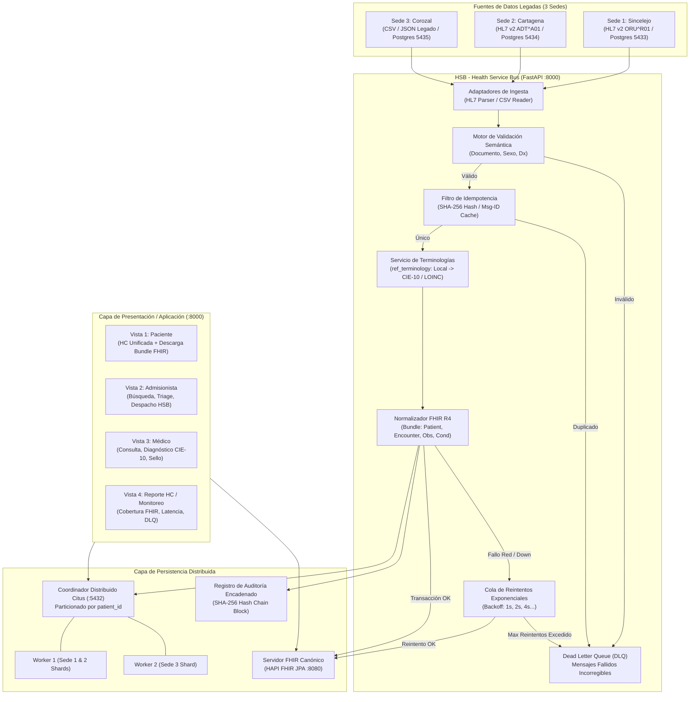
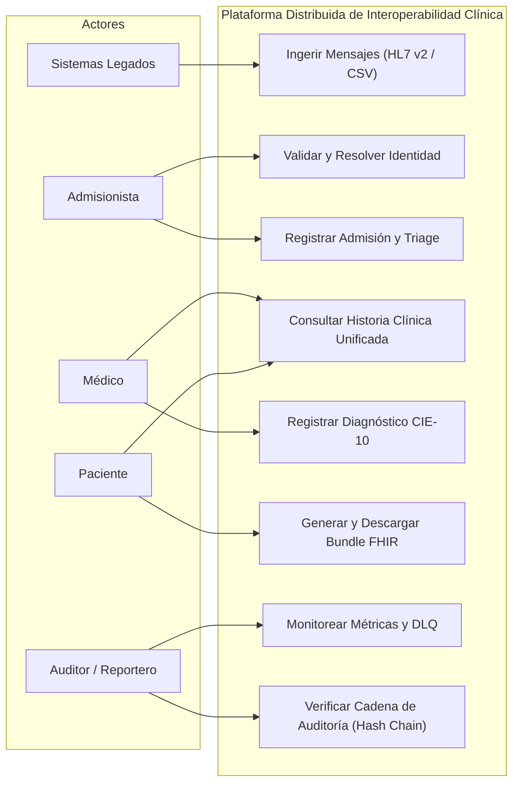
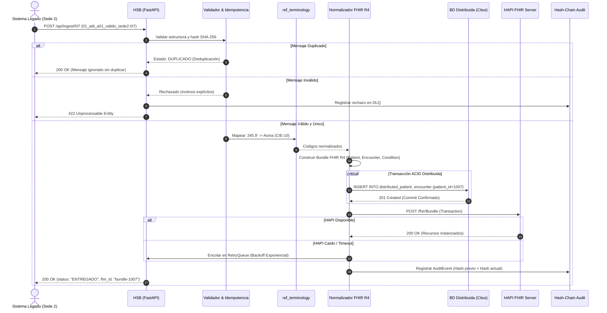
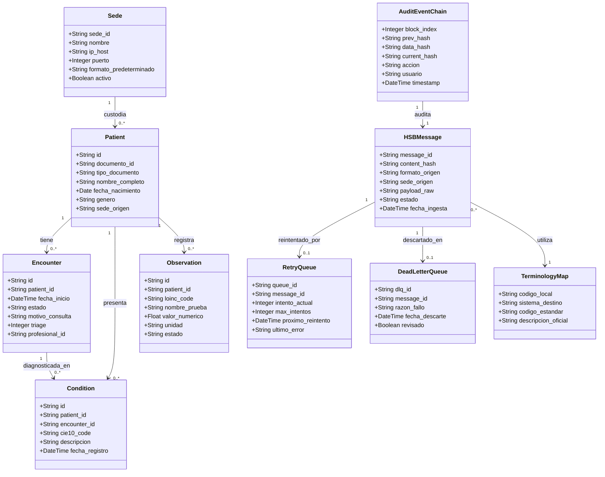
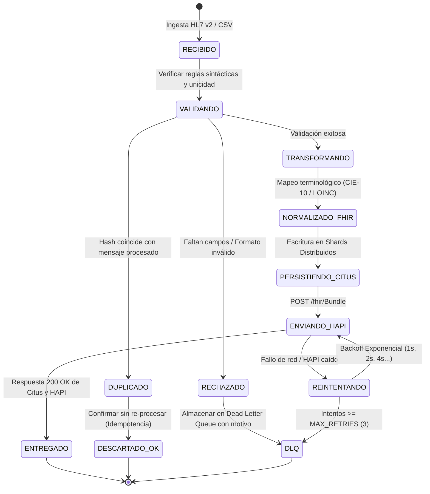

# FASE 1: ANÁLISIS, MODELADO UML Y DISEÑO ARQUITECTÓNICO
**Proyecto:** Plataforma Distribuida de Interoperabilidad Clínica (FHIR, HSB, BD Distribuida)  
**Curso:** Sistemas Distribuidos – Parcial Final  
**Integrantes:** Carlos Andrés Acosta Herrera & Juan David Benítez Ruiz  
**Institución:** Corporación Universitaria Antonio José de Sucre  

---

## 1. Diagrama de Arquitectura Global del Sistema

---

## 2. Los 4 Modelos UML Oficiales

### 2.1 Diagrama de Casos de Uso (UML)
Describe las interacciones de los cuatro roles con el sistema y el HSB.

---

### 2.2 Diagrama de Secuencia (UML)
Muestra la interacción temporal, validación, idempotencia, normalización FHIR y persistencia distribuida.

---

### 2.3 Diagrama de Clases (UML - >= 10 Entidades)
Estructura de clases canónicas del sistema, recursos FHIR R4 y entidades de infraestructura del HSB.

---

### 2.4 Diagrama de Estados (Ciclo de Vida del Mensaje en el HSB)

---

## 3. Tabla de Mapeo Semántico de Campos (>= 15 Campos)

| # | Campo Origen (HL7 / CSV Legado) | Segmento / Columna Origen | Recurso FHIR R4 Destino | Elemento FHIR R4 | Tipo de Dato | Terminología / Regla de Transformación |
|---|---|---|---|---|---|---|
| 1 | Identificador de Mensaje | MSH-10 | Bundle / MessageHeader | `Bundle.id` | id | Preserva ID único para idempotencia |
| 2 | Sede Emisora | MSH-4 | Provenance / ServiceRequest | `Provenance.agent.who` | Reference | Normaliza a Código Sede (SEDE1, SEDE2, SEDE3) |
| 3 | Fecha y Hora de Envío | MSH-7 | Bundle / MessageHeader | `Bundle.timestamp` | instant | Formato ISO 8601 (`YYYY-MM-DDTHH:MM:SSZ`) |
| 4 | Documento de Identidad | PID-3.1 / `documento` | Patient | `Patient.identifier.value` | string | Numérico >= 3 dígitos (Clave de partición) |
| 5 | Tipo de Identificador | PID-3.4 / Sistema HIS | Patient | `Patient.identifier.system` | uri | `urn:oid:co:ips:identificacion` |
| 6 | Apellidos del Paciente | PID-5.1 / `nombre` (split) | Patient | `Patient.name.family` | string | Normalización a mayúscula inicial |
| 7 | Nombres del Paciente | PID-5.2 / `nombre` (split) | Patient | `Patient.name.given` | string | Extrae nombres de pila |
| 8 | Fecha de Nacimiento | PID-7 / `nacimiento` | Patient | `Patient.birthDate` | date | Formato `YYYY-MM-DD` |
| 9 | Sexo / Género | PID-8 / `sexo` | Patient | `Patient.gender` | code | Mapeo obligatorio: M->male, F->female |
| 10 | Identificador del Encuentro | PV1-19 / Generado | Encounter | `Encounter.identifier.value` | string | Prefijo de sede: ej. `V-S2-0101` |
| 11 | Fecha de Atención | PV1-44 / `fecha` | Encounter | `Encounter.period.start` | dateTime | Formato ISO 8601 con zona horaria |
| 12 | Profesional a Cargo | PV1-7 / `profesional` | Encounter / Practitioner | `Encounter.participant.individual` | Reference | Código médico: ej. `MED-01` |
| 13 | Nivel de Triage | `triage` | Encounter | `Encounter.priority.coding.code` | code | Sistema Triage (1 Crítico a 5 No urgente) |
| 14 | Código de Diagnóstico | DG1-3.1 / `dx_local` | Condition | `Condition.code.coding.code` | code | Mapeo vía `ref_terminology` a CIE-10 |
| 15 | Descripción Diagnóstica | DG1-3.2 / Catálogo | Condition | `Condition.code.coding.display` | string | Catálogo oficial OMS / MinSalud |
| 16 | Código Prueba Laboratorio | OBR-4.1 / OBX-3.1 | Observation | `Observation.code.coding.code` | code | Normalización a LOINC (ej. `718-7`) |
| 17 | Nombre Prueba Laboratorio | OBR-4.2 / OBX-3.2 | Observation | `Observation.code.coding.display` | string | ej. Hemoglobina en sangre |
| 18 | Resultado Numérico | OBX-5 | Observation | `Observation.valueQuantity.value` | decimal | Valor numérico medido (ej. `13.8`) |
| 19 | Unidad de Medida | OBX-6 | Observation | `Observation.valueQuantity.unit` | string | Sistema UCUM (ej. `g/dL`) |
